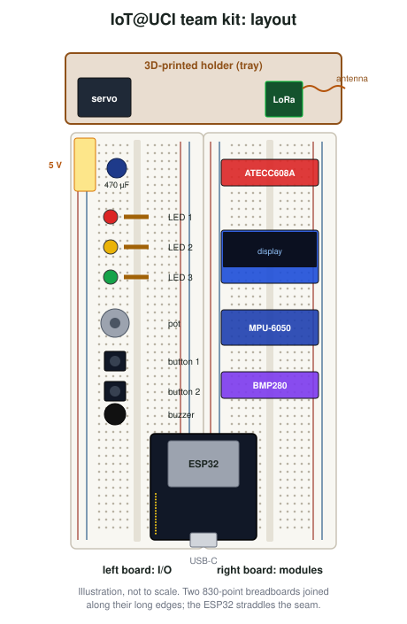
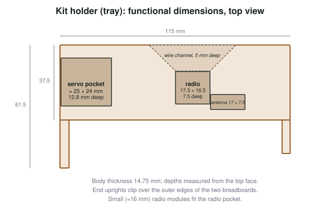
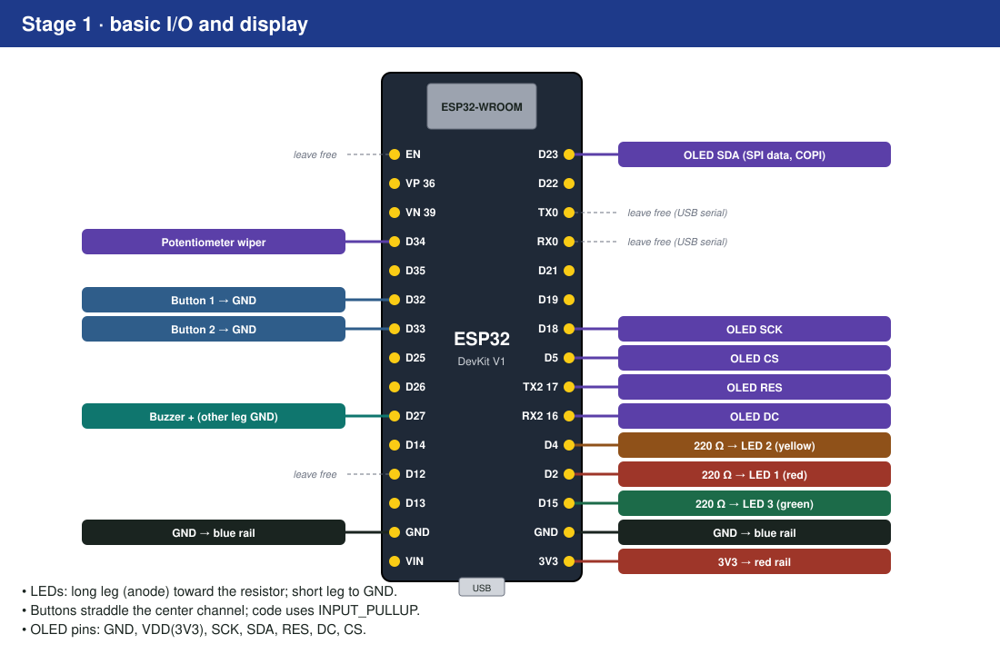
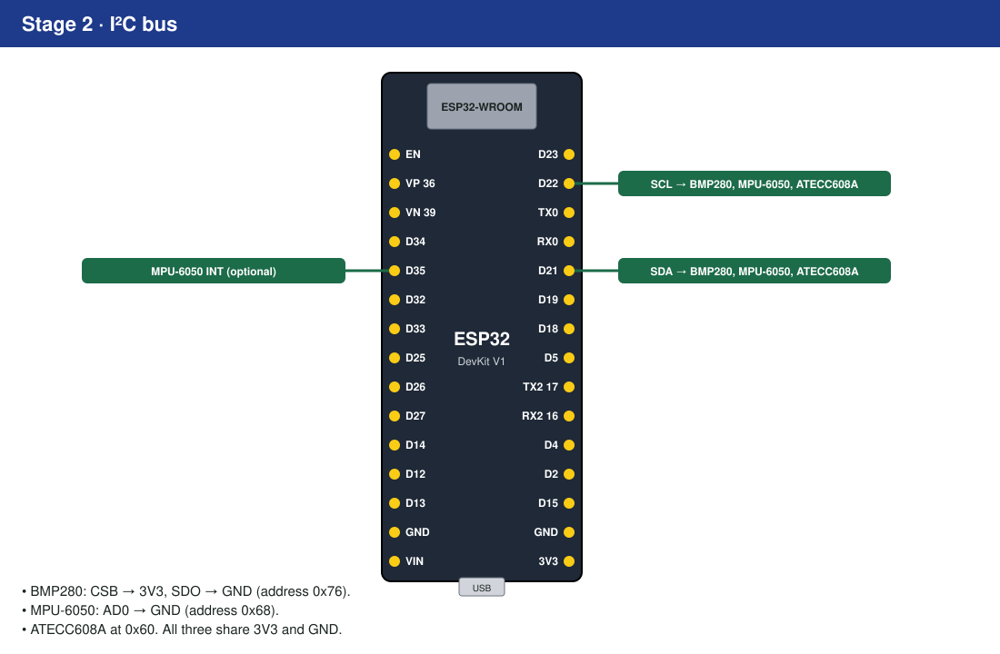
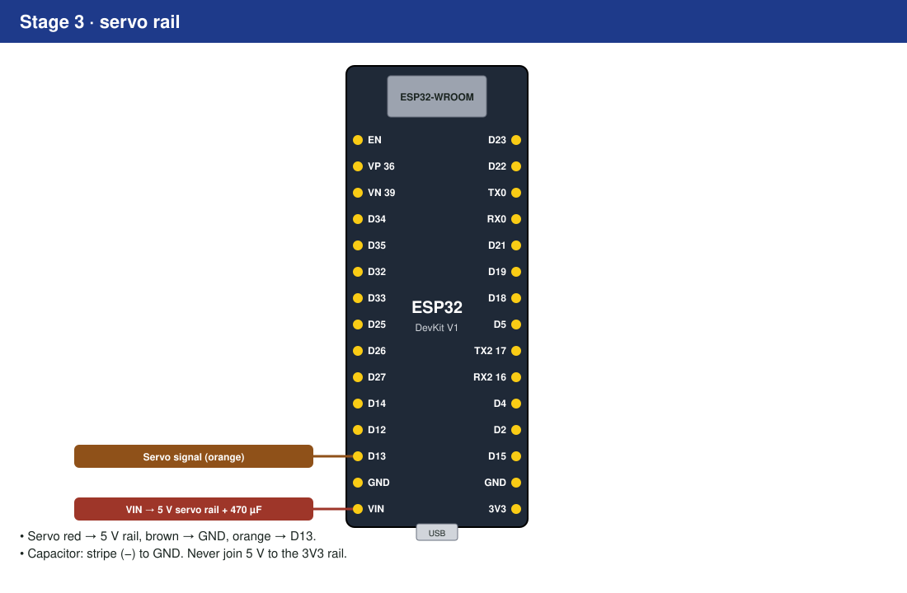
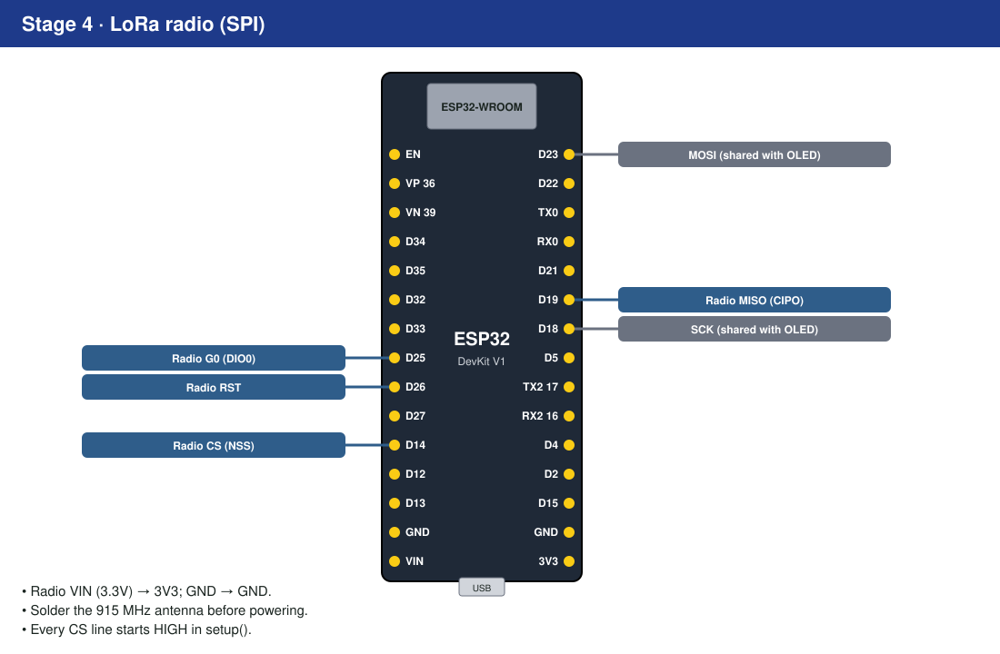

# Kit Reference {#sec-app-a}

::: {.callout-note appearance="simple"}
This appendix describes the IoT@UCI kit as built in Fall 2026, in enough detail for another course to build compatible kits. If your term's kit or starter code differs, **the starter's `iot_pins.h` is authoritative**. Photos of a finished kit will be added in a later release; the illustrations below show the layout.
:::

## What the finished kit looks like

{#fig-kit-layout width="70%"}

The layout follows a few deliberate rules:

- **Two 830-point breadboards**, joined along their long edges, give every module its own rows and leave space for project additions.
- **The ESP32 straddles the seam** between the boards, at the end nearest the edge of the desk, so the USB cable does not cross the circuit.
- **Left board, top to bottom**: the 5 V servo rail and its capacitor, three LEDs, the potentiometer, two buttons and the buzzer. These are the parts students touch.
- **Right board, top to bottom**: ATECC608A, OLED, MPU-6050, BMP280. All four sit on shared buses, so their header pins line up with the bus wiring.
- **The holder** at the top keeps the servo and radio from pulling on their wires.

## Bill of materials

Each kit is shared by a team of two or three students. Part numbers are the ones used in Fall 2026; equivalent parts work if they match the noted specifications.

| Qty | Part | Specification that matters | Fall 2026 source / part no. |
|---|---|---|---|
| 1 | ESP32 DevKit V1 (ESP32-WROOM-32), 30-pin, USB-C | 30-pin pinout shown in @fig-stage1 | AITRIP 4-pack, Amazon B0GBVDJLSF |
| 1 | USB-C to USB-C cable, 1 m | **Data** cable, not charge-only | SMAYS 10-pack, Amazon B0CC5J8GB7 |
| 2 | 830-point solderless breadboard | Split power rails are common; check | ELEGOO 3-pack, Amazon B01EV6LJ7G |
| 1 pack | Jumper wires (male–male) and 22 AWG solid-core wire | Solid core for flat wiring | ELEGOO 120-pack B01EV70C78; Adafruit #1311 |
| 3 | LEDs: red, yellow, green, 5 mm | | Assorted 600-pack, Amazon B0FL1T4ZHT |
| 3 | 220 Ω resistors, ¼ W | | Resistor assortment, Amazon B0F4P352BB |
| 2 | 6 × 6 mm tactile push buttons | 4-pin, fits across the center channel | DAOKI 100-pack, Amazon B01CGMP9GY |
| 1 | 10 kΩ linear potentiometer, breadboard-friendly | 0.1 in (2.54 mm) pin pitch | Adafruit #4133 (or #562) |
| 1 | Passive piezo buzzer | **Passive** (needs a tone), ≈12 mm | Adafruit #160 (PS1240) |
| 1 | 0.96 in 128 × 64 OLED, SSD1306, **7-pin SPI** | Pins GND, VDD, SCK, SDA, RES, DC, CS | UMLIFE 6-pack, Amazon B08SJW4J4P |
| 1 | BMP280 breakout, 3.3 V | 6-pin with CSB and SDO broken out | Amazon B0B38CBXG1 |
| 1 | MPU-6050 (GY-521) breakout | AD0 and INT broken out | HiLetgo 3-pack, Amazon B00LP25V1A |
| 1 | ATECC608A breakout | I²C, address 0x60 | SparkFun DEV-18077 (DigiKey) |
| 1 | SG90-class micro servo, 180° | 4.8–6 V, three-wire | Miuzei 10-pack, Amazon B072V529YD |
| 1 | 470 µF, 16 V electrolytic capacitor | ≥ 10 V rating | Nichicon UHE1C471MPD6 (DigiKey) |
| 1 | LoRa radio, 915 MHz (North America) | SX1276-based; small 16 × 16 mm module fits the holder | Adafruit RFM95W #3072, or bare RFM95W-915S2 |
| 1 | 915 MHz spring antenna (or 78 mm of 22 AWG wire) | Quarter-wave at 915 MHz | Adafruit #4269 |
| — | Header pins (male), 40-pin strips | Cut to length | Amazon B0774VBJ3J |
| 1 | Printed holder (tray) | See below | [Breadboard Snap-On Component Tray (830-point)](https://cults3d.com/en/3d-model/gadget/breadboard-snap-on-component-tray-830-point), designed by Alvin; free download, printed in PLA or PETG |

: Kit bill of materials. {#tbl-bom}

In Fall 2026 the parts for one new kit cost roughly **$55–60** at pack prices, excluding the printed holder, tax and shipping; the radio and the secure element account for about $23 of that.

::: {.callout-tip title="Why a quarter-wave antenna is 78 mm"}
A simple wire antenna works best at a quarter of the wavelength. At 915 MHz the wavelength is $\lambda = c / f = 3\times10^8 / 9.15\times10^8 \approx 0.328$ m, so $\lambda/4 \approx 82$ mm. A real wire is made slightly shorter (about 95%) because the signal travels a little slower along a conductor than in free space, which gives the familiar ≈78 mm.
:::

## The printed holder

The holder is a single printed part that clips over the outer edges of the two breadboards and carries the servo and the radio, so that they do not pull on their wires.

::: {.callout-note title="Get the holder file from its designer"}
The holder is the **Breadboard Snap-On Component Tray (830-point)**, designed by **Alvin** and shared as a free download on Cults3D: <https://cults3d.com/en/3d-model/gadget/breadboard-snap-on-component-tray-830-point>. Download the STL there rather than from a copy: the designer keeps it up to date based on feedback from users, and instructors who need a variation for their own kits can find his other designs on the same page. This book does not redistribute the file.
:::

{#fig-tray width="95%"}

Key dimensions (useful to check a print against the kit):

| Feature | Value | Why |
|---|---|---|
| Body | 115 × 37.5 mm, 14.75 mm thick | Spans two 55 mm-wide breadboards plus clip walls |
| End uprights | ≈ 4 mm wide, extending to 61.5 mm | Clip over the breadboards' outer edges |
| Servo pocket | ≈ 25 × 24 mm, 12.8 mm deep | SG90 body (≈ 23 × 12 × 23 mm) lying on its side, with clearance |
| Radio pocket | ≈ 17.3 × 16.3 mm, 7.5 mm deep | Bare 16 × 16 mm RFM95W module |
| Antenna arm | ≈ 17 × 7.5 mm | Keeps the spring antenna away from the board |
| Wire channel | Tapered, 5 mm deep | Routes the radio's wires down to the right breadboard |

Larger breakout-style radios (such as the 29 × 25 mm RadioFruit board) do **not** fit the radio pocket; they sit on the right breadboard instead.

Printing tips: PLA or PETG, 0.2 mm layers, 15–20% infill, no supports if printed pocket-side up. Print one, test-fit a servo, a radio and both breadboards, then print the rest.

## Wiring by stage

The kit is wired in four stages, each just before the chapter that first needs it ([Lab 1](/part7-lab-companion/L1-build-the-kit.qmd)).

{#fig-stage1 width="100%"}

{#fig-stage2 width="100%"}

{#fig-stage3 width="100%"}

{#fig-stage4 width="100%"}

## Pin map

| Function | GPIO | Notes |
|---|---|---|
| LED 1 (red) | 2 | Strapping pin; also the board's blue LED on many DevKits |
| LED 2 (yellow) | 4 | |
| LED 3 (green) | 15 | Strapping pin |
| Button 1 | 32 | `INPUT_PULLUP`, active low |
| Button 2 | 33 | `INPUT_PULLUP`, active low |
| Potentiometer wiper | 34 | Input-only, ADC1 |
| Buzzer | 27 | LEDC channel shared with `tone()` |
| Servo signal | 13 | On its own LEDC channel; powered from the 5 V rail |
| I²C SDA | 21 | BMP280 0x76, MPU-6050 0x68, ATECC608A 0x60 |
| I²C SCL | 22 | |
| MPU-6050 INT (optional) | 35 | Input-only |
| SPI SCK | 18 | Shared: OLED, LoRa |
| SPI COPI (MOSI) | 23 | Shared: OLED ("SDA" on the module), LoRa |
| SPI CIPO (MISO) | 19 | LoRa only |
| OLED CS | 5 | Strapping pin |
| OLED DC | 16 | |
| OLED RES | 17 | |
| LoRa CS (NSS) | 14 | |
| LoRa RST | 26 | |
| LoRa G0 (DIO0) | 25 | |

: Kit pin map. {#tbl-pinmap}

**Free pins** for project additions include GPIO 12 (a strapping pin: must not be pulled high at boot), 36 and 39 (input-only). Check @tbl-esp32-pins before using any pin.

## `iot_pins.h`

The starter projects define the pins in one header, so code refers to names rather than numbers:

```cpp
#pragma once
#include <stdint.h>

namespace IoTPins {
  // Stage 1
  constexpr uint8_t LED_1    = 2;    // red
  constexpr uint8_t LED_2    = 4;    // yellow
  constexpr uint8_t LED_3    = 15;   // green
  constexpr uint8_t BUTTON_1 = 32;
  constexpr uint8_t BUTTON_2 = 33;
  constexpr uint8_t POT_ADC  = 34;
  constexpr uint8_t BUZZER   = 27;
  constexpr uint8_t SPI_SCK  = 18;
  constexpr uint8_t SPI_MOSI = 23;
  constexpr uint8_t SPI_MISO = 19;
  constexpr uint8_t OLED_CS  = 5;
  constexpr uint8_t OLED_DC  = 16;
  constexpr uint8_t OLED_RES = 17;
  // Stage 2
  constexpr uint8_t I2C_SDA  = 21;
  constexpr uint8_t I2C_SCL  = 22;
  constexpr uint8_t MPU6050_INT = 35;
  // Stage 3
  constexpr uint8_t SERVO    = 13;
  // Stage 4
  constexpr uint8_t LORA_CS  = 14;
  constexpr uint8_t LORA_RST = 26;
  constexpr uint8_t LORA_G0  = 25;
}

namespace IoTAddr {
  constexpr uint8_t BMP280    = 0x76;
  constexpr uint8_t MPU6050   = 0x68;
  constexpr uint8_t ATECC608A = 0x60;
}
```

## Power

- The board is powered from USB (5 V), regulated to **3.3 V** for the ESP32 and the 3V3 rails.
- **VIN** carries the USB 5 V (minus a diode drop on some boards) and feeds only the **servo rail**.
- Budget: the 3.3 V regulator on a typical DevKit supplies several hundred milliamperes, and Wi-Fi transmission alone can draw up to about 250 mA in bursts. Do not power motors or additional radios from 3V3.

## Kit care

- Unplug USB before changing wiring.
- Keep the antenna attached to the LoRa radio.
- Store the kit with wires pressed flat and parts seated; loose parts are the most common cause of "it worked yesterday".
- Report damaged parts to the teaching staff rather than swapping in parts from elsewhere.
