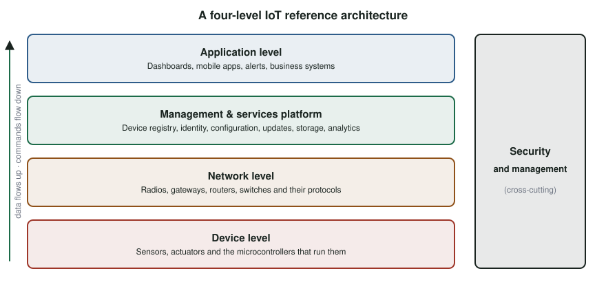

# What Is the Internet of Things? {#sec-ch01}

::: {.callout-tip title="Learning objectives" appearance="simple"}
After this chapter you should be able to:

1. Define the Internet of Things and name the four capabilities every IoT system combines.
2. Explain how IoT differs from the "Internet of People" that came before it.
3. Describe a four-level reference architecture and place real components in it.
4. Recognize the major application domains and the engineering questions they raise.
5. List the cross-cutting concerns (security, interoperability, reliability, efficiency) that the rest of this book addresses.
:::

## Why it matters

In 2024 there were about 18.5 billion connected IoT devices in the world, more than two for every person. Analysts expected roughly 21 billion in 2025 and close to 40 billion by 2030 [@iotanalytics_state_2025]. Most of them are not phones or laptops. They are thermostats, parking sensors, infusion pumps, irrigation valves, shipping-container trackers and factory motors.

Each of these devices is a small computer that senses something in the physical world, decides what it means, and either acts on it or reports it to someone who will. Building such devices well requires knowledge that usually lives in separate courses: electronics, embedded programming, networking, distributed systems and security. This book brings them together around one question: **how do you build a small device that reliably senses, decides, communicates and acts?**

## Concepts

### A working definition

There is no single official definition of the Internet of Things, but most definitions agree on four ingredients. An IoT system is a network of physical things that have:

- **Sensors**, to collect information about the world;
- **Identifiers**, so that every piece of data can be traced to the device that produced it;
- **Software**, to process and interpret the data;
- **Connectivity**, so that data and commands can travel between devices, people and services.

Putting these together:

> The **Internet of Things** is the network of physical objects that are embedded with sensors, software and network connectivity, have a unique identity, and can collect and exchange data and act on the physical world.

Notice the last clause. Many IoT devices do not just observe; they also **actuate**: they open valves, lock doors, dim lights and move motors. A device that can change the physical world raises the stakes of every design decision, from how fast it responds to who is allowed to command it.

### Related terms

You will meet several overlapping terms in the literature:

| Term | Emphasis |
|---|---|
| **M2M** (machine-to-machine) | Devices talking directly to each other, often over cellular links, without a person in the loop. The older industrial term. |
| **Wireless sensor networks** | Large numbers of small, battery-powered sensing nodes; mostly research-driven. |
| **Industrial IoT** (IIoT) | Factories, energy and process control, where reliability and safety dominate. |
| **Web of Things** | Using web standards (HTTP, URLs, JSON) to expose devices as resources. |
| **Internet of Everything** | A marketing term that adds people, processes and data to the picture. |
| **Cyber-physical systems** | The academic term for tightly coupled computation and physical processes. |

These are not competing technologies. They are different lenses on the same idea.

### From the Internet of People to the Internet of Things

The internet has gone through several phases, each of which digitized something new:

1. **Connectivity** digitized *access to information*: email, the web, search.
2. **The networked economy** digitized *business*: e-commerce, online banking, supply chains.
3. **Immersive experiences** digitized *interaction*: social media, video, mobile apps.
4. **The Internet of Things** digitizes *the physical world itself*.

The first three phases mostly connected people to applications. Almost every packet started or ended at a person looking at a screen. In the IoT, most traffic is between machines, and a person may never see the raw data at all. This changes the design priorities. A web page can take a second to load; a braking system cannot. A phone is recharged daily; a soil sensor may need to run for five years on one battery.

Connecting objects is not a goal in itself. The value comes from turning the data into **better decisions** (for example, scheduling maintenance before a pump fails) and delivering the right information to the right person or machine **at the right time**.

### Three kinds of connection

It helps to classify IoT interactions by who is talking:

- **People to things.** A person monitors or controls a device: checking a home camera, adjusting a thermostat, reading an ECG from a wearable.
- **Things to people.** A device notifies a person: a leak alert, a low-battery warning, a door left open.
- **Things to things.** Devices coordinate without a person: a motion sensor turns on a light, a traffic signal adapts to a queue of cars, a fleet of warehouse robots avoids collisions.

The third category grows fastest and is the hardest to get right, because no person is in the loop to notice when something goes wrong.

### A reference architecture

Real IoT systems are built from many products made by different vendors. A **reference architecture** gives you a common vocabulary for where each part belongs. A widely used model has four levels (@fig-iot-architecture):

{#fig-iot-architecture width="95%"}

1. **Device level.** The *things*: sensors, actuators and the microcontrollers that run them. Your kit lives here.
2. **Network level.** Everything that moves data: radios, gateways, routers and switches, and the protocols they use. A gateway often translates between a local radio (Bluetooth, LoRa, Zigbee) and the internet.
3. **Management and services platform level.** Software that manages fleets of devices and their data: device registration and identity, configuration, firmware updates, data storage, rules engines and analytics. Cloud IoT platforms and MQTT brokers live here.
4. **Application level.** The applications people and businesses actually use: dashboards, mobile apps, alerting, and integration with business systems.

Two concerns cut across every level: **security** (who may read, send or change what) and **management** (how you find, configure, update and retire devices once they are deployed). Much of this book is organized around this picture. Parts I and II focus on the device level, Part III on the network level, Part IV on the cross-cutting concerns, and Parts V and VI on how the levels come together into a working system.

### Application domains

IoT appears in almost every industry. A few domains recur throughout the book:

- **Smart homes and buildings**: lighting, heating and cooling, locks, appliances and energy metering. Interoperability between brands is the central challenge (@sec-ch13).
- **Smart cities**: parking, street lighting, waste collection, air-quality monitoring and traffic management. Devices are spread over kilometers and must run for years, which favors long-range, low-power radios (@sec-ch10).
- **Healthcare and wellness**: wearables, remote patient monitoring and connected medical devices. Privacy, safety and regulation dominate.
- **Transportation and logistics**: vehicle telematics, fleet tracking and cold-chain monitoring of goods in transit.
- **Industry and agriculture**: predictive maintenance, process monitoring, irrigation control and livestock tracking.

Each domain weighs the same trade-offs differently. A smart-home light switch must respond in well under a second but can draw mains power. A soil-moisture sensor can report once an hour but must run on a battery for years.

### The questions every IoT system must answer

The basic promise of IoT is to **monitor and control things from anywhere**. Delivering that promise raises a set of questions that this book takes up one at a time:

| Question | Where it is covered |
|---|---|
| How does a device sense and act on the world? | Parts I and II |
| How does it reach the network, and the network reach it? | Part III |
| Who is allowed to monitor and control it, and how is that enforced? | Part IV |
| How do devices from different makers work together? | @sec-ch13 |
| How do we make it reliable when it is unattended for years? | @sec-ch16, @sec-ch21 |
| How do we make it efficient in energy, bandwidth and cost? | Throughout |
| Where should the "thinking" happen: device, edge or cloud? | @sec-ch18 |

::: {.callout-tip title="Try it on your kit: place the kit in the architecture"}
Look at the kit tour in *Using This Book with the IoT@UCI Kit*.

1. For each part in the kit, decide which level of @fig-iot-architecture it belongs to.
2. The kit has no gateway. Which kit component will eventually play that role for the LoRa radio, and what will it connect to?
3. Name one application-level product you use daily that sits on top of a device-level thing. What are its sensors, identifiers, software and connectivity?
:::

## Design trade-offs

Every IoT design balances a small set of competing goals. It is worth naming them now, because they will reappear in every chapter:

| Goal | Typically in tension with |
|---|---|
| Long battery life | Frequent sensing, fast response, high data rates |
| Long radio range | Data rate and energy per bit |
| Low unit cost | Security hardware, extra sensors, certification |
| Rich local processing | Power, cost and complexity of the device |
| Strong security | Usability, cost and development time |
| Openness and interoperability | Speed to market and vendor control |

There is no universally right answer. A good IoT engineer can state which goals matter most for a given product and justify the trade-offs that follow.

## Common pitfalls

- **Connecting things because you can.** A device should be connected because the data or the remote control creates value, not because a radio is cheap.
- **Designing for the demo, not the deployment.** A prototype on a desk has unlimited power, perfect Wi-Fi and a developer watching it. A deployed device has none of these.
- **Treating security as a feature to add later.** Retrofitting identity, encryption and updates into deployed devices is expensive and sometimes impossible.
- **Ignoring the people involved.** Someone installs, maintains and eventually discards every device. Their time and skills are part of the system.

::: {.callout-note title="Advanced track" collapse="true"}
**Reference architectures in standards.** The four-level model above is a simplified version of several formal architectures, including the ITU-T Y.2060 IoT reference model, the IEEE 2413 architectural framework and ISO/IEC 30141. They differ in naming and in how they divide responsibilities, but they all separate devices, networks, services and applications, and they all treat security and management as cross-cutting.

**Exercise.** Choose a commercial IoT product (for example a video doorbell, a connected car or a smart meter). Draw it on the four-level architecture, naming the actual products, protocols and companies at each level. Identify which party controls each level, and what happens to the product if that party goes out of business.
:::

## Check your understanding

1. Name the four ingredients that most definitions of the IoT share, and give an example of each from a smart thermostat.
2. Why is "connecting objects together" not, by itself, the goal of an IoT system?
3. Explain one way in which IoT traffic differs from traffic in the "Internet of People".
4. At which level of the reference architecture would you place: a LoRa gateway; a firmware-update service; a temperature sensor; a mobile app showing a room's temperature?
5. Give one domain where battery life is the dominant constraint, and one where response time is.
6. Why are security and management drawn as cross-cutting concerns rather than as a fifth level?

## Further reading

- IoT Analytics, *State of IoT 2025* [@iotanalytics_state_2025], for current device counts and connectivity trends.
- ITU-T Recommendation Y.2060, *Overview of the Internet of Things* [@itu_y2060], the source of many reference-architecture terms.
