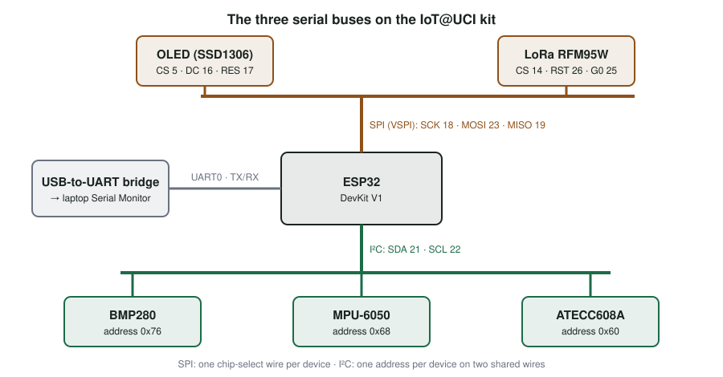
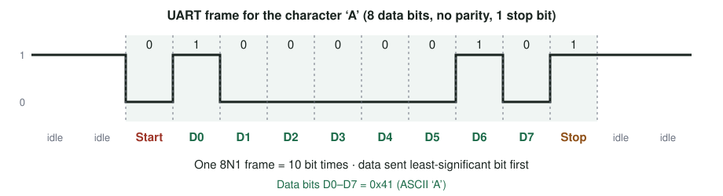
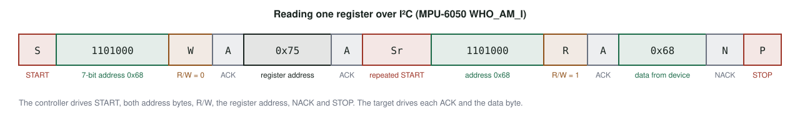

# Serial Communication: UART, SPI and I²C {#sec-ch05}

::: {.callout-tip title="Learning objectives" appearance="simple"}
After this chapter you should be able to:

1. Explain why embedded devices move data serially, and distinguish synchronous from asynchronous links.
2. Describe how UART, SPI and I²C frame, clock and address their data.
3. Choose the right bus for a given peripheral, and justify the choice in terms of wires, speed, distance and number of devices.
4. Connect, scan and read devices on the kit's I²C and SPI buses from ESP32 code.
5. Diagnose the most common wiring and configuration faults on each bus.
:::

## Why it matters

Open almost any IoT device and you will find a microcontroller surrounded by smaller chips: a temperature sensor, a motion sensor, a display, a radio, a secure element. The microcontroller is the only part that runs your code. Everything the device *senses*, *shows* or *transmits* reaches it over a handful of wires.

Your kit is a good example. Its ESP32 talks to a computer, two sensors, a security chip, a display and a LoRa radio over about a dozen signal wires, most of them shared. It manages this because it uses three different serial protocols, each designed for a different job (@fig-kit-buses).

{#fig-kit-buses width="100%"}

Choosing the wrong bus, or wiring the right one carelessly, is one of the most common reasons an IoT prototype does not work. This chapter gives you the vocabulary and the mental model to get it right.

## Concepts

### Protocols, parallel and serial

A **communication protocol** is an agreement between two or more parties about how information is exchanged: the *syntax* (how bits are grouped), the *semantics* (what they mean), and the *synchronization* (when each bit is valid). Protocols also say what happens when something goes wrong.

Suppose you want to move one byte from one ESP32 to another. The simplest approach is **parallel** communication: use eight wires, one per bit, and set them all at once. Parallel buses are fast and are still used inside computers, for example between a processor and its memory.

Parallel links do not scale well for small devices, though. Each extra bit costs a pin, a trace and a wire, and microcontrollers have few pins to spare. Over longer wires, the bits also stop arriving at exactly the same moment. **Serial** communication solves both problems by sending the bits one after another over a single data line, and adding just enough control information for the receiver to reassemble them.

Two properties describe any serial link:

- **Synchronization.** In a **synchronous** link, one side drives a separate *clock* wire that tells the receiver exactly when to read each bit. In an **asynchronous** link there is no clock wire, so both sides must agree on the bit rate in advance and resynchronize on every frame.
- **Direction.** A **simplex** link carries data one way only. A **half-duplex** link carries data both ways, but only one way at a time. A **full-duplex** link carries data both ways simultaneously.

::: {.callout-note title="A note on terminology"}
Older documents describe bus roles as *master* and *slave*, and name SPI pins MOSI and MISO. Current specifications use **controller** and **target** for I²C [@nxp_i2c_um10204], and many vendors now use **controller** and **peripheral** for SPI, with pins named COPI (controller out, peripheral in) and CIPO. This book uses the modern terms. You will still see the older labels printed on modules and in the Arduino API, and they mean the same thing.
:::

### UART: asynchronous serial

A **UART** (Universal Asynchronous Receiver/Transmitter) is a hardware block, not a protocol in itself. It turns bytes into a timed stream of bits on a transmit (TX) wire, and turns the bit stream arriving on a receive (RX) wire back into bytes.

#### The frame

Because there is no clock wire, every byte is wrapped in a **frame** that the receiver can recognize on its own (@fig-uart-frame):

1. The line **idles high**.
2. A **start bit** pulls the line low for one bit time. This falling edge tells the receiver a byte is coming and where its bits begin.
3. Five to nine **data bits** follow, *least-significant bit first*. Eight is almost universal.
4. An optional **parity bit** allows simple error detection.
5. One or two **stop bits** return the line high, so the next start bit always produces a fresh falling edge.

{#fig-uart-frame width="100%"}

A configuration is usually written in shorthand such as **8N1**: 8 data bits, no parity, 1 stop bit. The receiver samples each bit near the middle of its time slot, which gives it some tolerance for timing error.

#### Baud rate and throughput

The **baud rate** is the number of bit times per second. Both sides must be set to the same value. Common rates are 9600 and 115200 baud.

The framing bits are overhead. In 8N1, each byte costs 10 bit times, so a link at 115200 baud moves at most

$$
\frac{115\,200 \text{ bits/s}}{10 \text{ bits/byte}} = 11\,520 \text{ bytes/s}.
$$

If the two sides disagree on the baud rate, the receiver samples at the wrong moments and the error accumulates across the frame. A mismatch of a few percent is enough to corrupt data. A large mismatch produces the familiar screen full of random characters in the Serial Monitor.

#### Wiring

A UART link is **point-to-point** between two devices:

- Connect each device's **TX to the other's RX**, not TX to TX.
- **Connect the grounds.** The receiver measures voltage relative to its own ground, so without a common reference the levels are meaningless.
- Check the **logic levels**. The ESP32 uses 3.3 V signals. Connecting a 5 V device's TX directly to an ESP32 input can damage it.

#### UART on the ESP32

The ESP32 has three UART controllers. On the DevKit V1, **UART0** is wired to a USB-to-UART bridge chip on the board. That is the link you use every time you upload code or open the Serial Monitor, so avoid using its pins for anything else. The other two UARTs can be routed to almost any free GPIO pins through the ESP32's pin multiplexer [@espressif_esp32_trm].

In the Arduino framework, each UART is a `HardwareSerial` object:

```{.cpp lst-cap="Echoing bytes on UART0 and opening a second UART on chosen pins."}
#include <Arduino.h>

constexpr int UART2_RX = 16;   // example pins; check your pin map first
constexpr int UART2_TX = 17;

void setup() {
  Serial.begin(115200);                                  // UART0 → USB → laptop
  Serial2.begin(9600, SERIAL_8N1, UART2_RX, UART2_TX);   // e.g., a GPS module
}

void loop() {
  if (Serial.available() > 0) {        // bytes waiting in the receive buffer?
    int b = Serial.read();             // take one byte
    Serial.printf("Received 0x%02X ('%c')\n", b, b);
  }
}
```

The course helper `iotStartSerial()` wraps `Serial.begin(115200)` and prints a banner, which is why the Serial Monitor in every activity is set to 115200 baud.

#### Strengths and limits

UART is simple, needs only two wires, and every microcontroller has one. That is why it remains the standard way to talk to a development board, and why modules such as GPS receivers and cellular modems still use it.

Its limits follow from its design. It connects only two devices. It spends 20% of the line on framing. Both sides must agree on the speed in advance. Inside devices, most chip-to-chip links have moved to SPI and I²C.

### SPI: the fast synchronous bus

The **Serial Peripheral Interface** (SPI) is a synchronous bus introduced by Motorola in the 1980s [@freescale_spi_block_guide]. It has no formal standard, but it is supported by almost every microcontroller and by thousands of peripherals.

#### Signals and topology

One **controller** (the ESP32) drives the bus. Three wires are shared by every device:

- **SCK**, the clock, always driven by the controller.
- **COPI** (MOSI), data from controller to peripheral.
- **CIPO** (MISO), data from peripheral to controller.

Each peripheral also gets its own **chip select** (CS) wire. CS is *active low*: the controller pulls one device's CS low to talk to it, and keeps every other CS high. A deselected peripheral must ignore the clock and release CIPO, so devices do not fight over the shared line.

On every clock pulse, the controller shifts one bit out on COPI while the selected peripheral shifts one bit back on CIPO. SPI is therefore **full duplex**, and the hardware inside a simple peripheral can be little more than a shift register. Because the controller generates every clock edge, a peripheral can only send data while the controller is clocking. If the controller wants to read a reply, it must keep clocking (usually by sending dummy bytes) for as many bytes as it expects.

#### Clock modes

Devices disagree about which clock edge marks a valid bit. Two settings describe the convention:

- **CPOL** (clock polarity): whether the clock idles low (0) or high (1).
- **CPHA** (clock phase): whether data is sampled on the first (0) or second (1) clock edge of each bit.

| Mode | CPOL | CPHA | Clock idles | Data sampled on |
|---|---|---|---|---|
| 0 | 0 | 0 | Low | Rising edge |
| 1 | 0 | 1 | Low | Falling edge |
| 2 | 1 | 0 | High | Falling edge |
| 3 | 1 | 1 | High | Rising edge |

: The four SPI modes. Mode 0 is the most common. {#tbl-spi-modes}

The controller must use the mode the peripheral expects, which is given in the peripheral's datasheet. Most devices also send the **most significant bit first**.

#### Speed

SPI has no addressing overhead and no framing bits, and its push-pull outputs switch quickly. Clock rates of 10 MHz or more are routine, which makes SPI the usual choice for displays, radios, SD cards and flash memory. The practical limit is set by the slowest device on the bus and by the length of the wires.

#### SPI on the ESP32

The ESP32 has four SPI controllers. Two of them (SPI0 and SPI1) are reserved for the external flash chip that holds your program. The other two, **HSPI** and **VSPI**, are free for peripherals [@espressif_esp32_trm]. The kit uses VSPI on its default pins: SCK on GPIO 18, COPI on GPIO 23 and CIPO on GPIO 19. Using a controller's default pins gives the highest clock rates; routing SPI signals to other pins through the GPIO matrix works, but lowers the maximum speed.

The kit puts two devices on this bus (@fig-kit-buses):

- The **OLED display** (CS on GPIO 5) only receives data, so it never uses CIPO. It has an extra **D/C** pin that tells it whether each byte is a command or pixel data.
- The **LoRa radio** (CS on GPIO 14), added in @sec-ch10, both receives commands and returns data, so it uses CIPO.

Because different devices may need different speeds and modes, the Arduino SPI library groups those settings into a *transaction*:

```{.cpp lst-cap="One SPI transaction: select the device, exchange bytes, release it."}
#include <SPI.h>

constexpr int LORA_CS = 14;

uint8_t readRadioRegister(uint8_t reg) {
  SPI.beginTransaction(SPISettings(8000000, MSBFIRST, SPI_MODE0));
  digitalWrite(LORA_CS, LOW);          // select the radio
  SPI.transfer(reg & 0x7F);            // send the register address (top bit 0 = read)
  uint8_t value = SPI.transfer(0x00);  // clock out a dummy byte, clock in the reply
  digitalWrite(LORA_CS, HIGH);         // release the bus
  SPI.endTransaction();
  return value;
}

void setup() {
  pinMode(LORA_CS, OUTPUT);
  digitalWrite(LORA_CS, HIGH);         // every CS starts deselected
  SPI.begin(18, 19, 23);               // SCK, CIPO (MISO), COPI (MOSI)
}
```

Notice that reading one byte takes two transfers: the first sends the register address, and the second exists only to generate eight clock pulses so the radio can answer.

#### Strengths and limits

SPI is fast, full duplex and simple to implement in hardware. Its costs are wiring and coordination. Every additional device needs another CS wire. There is no acknowledgment, so the controller cannot tell whether anyone is listening. Peripherals cannot start a conversation on their own, and they cannot talk to each other.

When there are more peripherals than spare pins, designers either add a decoder chip that turns a few pins into many chip selects, or **daisy-chain** devices so that data shifts through one into the next. Daisy-chaining suits output-only devices such as LED drivers.

### I²C: two wires, many devices

**I²C** (Inter-Integrated Circuit, pronounced "I-squared-C") was created by Philips in 1982 to connect many chips inside a television using as few wires as possible. Today it is the default bus for low-speed sensors and is defined by a published specification [@nxp_i2c_um10204].

#### Two wires and an address

Every device on an I²C bus shares just two lines:

- **SCL**, the serial clock, driven by the controller.
- **SDA**, serial data, driven by whichever side is sending.

Instead of chip-select wires, each target has a **7-bit address**. The controller begins every transaction by sending an address, and only the target with that address responds. The kit's three I²C devices sit on the same two wires at addresses 0x76 (BMP280), 0x68 (MPU-6050) and 0x60 (ATECC608A). A few addresses are reserved by the specification, so the usable range is 0x08 to 0x77.

Many breakout boards let you choose between two addresses with a pin or a jumper. The BMP280 answers at 0x76 or 0x77 depending on its SDO pin, and the MPU-6050 at 0x68 or 0x69 depending on its AD0 pin [@bosch_bmp280; @invensense_mpu6050]. That is how two identical sensors can share a bus.

#### Open drain and pull-up resistors

I²C outputs are **open drain**: a device can pull a line *low*, but it can never drive it *high*. Instead, a **pull-up resistor** on each line returns it to the supply voltage whenever nobody is pulling down.

This design has two important consequences:

- **No device can short the bus.** If one device holds the line low while another releases it, the line is simply low. This is what makes acknowledgments, arbitration and clock stretching (below) safe.
- **The pull-ups set the speed.** The rising edge is only as fast as the resistor can charge the capacitance of the wires and inputs. Larger resistors save power but slow the edges; smaller ones allow faster edges but force each device to sink more current when it pulls low. Values between about 2.2 kΩ and 10 kΩ are typical.

Most sensor breakout boards include their own pull-up resistors. When several boards share a bus, their pull-ups act in parallel, so the effective resistance drops as you add boards. That is usually harmless with two or three boards, but worth checking as a bus grows.

#### Transactions, ACK and NACK

An I²C transaction is built from 9-bit units: eight data bits, most significant first, followed by one **acknowledge** bit (@fig-i2c-read).

1. The controller sends a **START** condition: SDA falls while SCL is high. Data never changes while SCL is high, so this pattern is unmistakable.
2. The controller sends the 7-bit address and a **read/write** bit (0 = write, 1 = read).
3. The addressed target pulls SDA low during the ninth clock to **acknowledge** (ACK). If no device has that address, SDA stays high: a **NACK**.
4. Data bytes follow, each acknowledged by the receiver.
5. The controller ends with a **STOP** condition: SDA rises while SCL is high.

Most sensors expose their data as numbered **registers**. To read a register, the controller first *writes* the register number, then uses a **repeated START** (a START without a STOP in between) to switch to *reading* without giving up the bus.

{#fig-i2c-read width="100%"}

```{.cpp lst-cap="Reading one register over I²C with a repeated START."}
#include <Wire.h>

constexpr uint8_t MPU6050_ADDR = 0x68;
constexpr uint8_t WHO_AM_I     = 0x75;

int readRegister(uint8_t addr, uint8_t reg) {
  Wire.beginTransmission(addr);
  Wire.write(reg);                          // which register we want
  if (Wire.endTransmission(false) != 0) {   // false = repeated START, keep the bus
    return -1;                              // NACK: nobody at this address
  }
  Wire.requestFrom(addr, (uint8_t)1);       // read one byte, then STOP
  return Wire.available() ? Wire.read() : -1;
}

void setup() {
  Serial.begin(115200);
  Wire.begin(21, 22);                       // SDA, SCL
  Serial.printf("WHO_AM_I = 0x%02X\n", readRegister(MPU6050_ADDR, WHO_AM_I));
}

void loop() {}
```

#### Scanning a bus

Because a missing device answers with a NACK, the controller can discover what is connected simply by addressing every possible target and noting which ones acknowledge. This **bus scan** is the first thing to run on any new I²C wiring.

```{.cpp lst-cap="An I²C bus scanner."}
#include <Wire.h>

void setup() {
  Serial.begin(115200);
  Wire.begin(21, 22);
  int found = 0;
  for (uint8_t addr = 0x08; addr <= 0x77; addr++) {
    Wire.beginTransmission(addr);
    if (Wire.endTransmission() == 0) {     // 0 = the address was acknowledged
      Serial.printf("Found device at 0x%02X\n", addr);
      found++;
    }
  }
  Serial.printf("%d device(s) found\n", found);
}

void loop() {}
```

#### Speed, clock stretching and multiple controllers

I²C runs at defined speeds: **100 kHz** (Standard-mode), **400 kHz** (Fast-mode) and **1 MHz** (Fast-mode Plus), with faster modes defined for special hardware [@nxp_i2c_um10204]. Address bytes, acknowledgments and the slow rising edges make it much slower than SPI in practice, which is acceptable for sensors that produce a few readings per second. On the ESP32, `Wire.setClock(400000)` selects Fast-mode.

Open-drain outputs also make two advanced features possible:

- **Clock stretching.** A target that needs more time can hold SCL low after a byte. The controller waits until SCL is released.
- **Multiple controllers.** Two controllers can share a bus. If both start at once, each watches SDA while sending; the first one to send a 1 while the line reads 0 knows it has lost **arbitration** and backs off.

#### Strengths and limits

I²C needs only two wires for up to dozens of devices, confirms that each byte was received, and lets software find devices by scanning. Its costs are speed and fragility: it is half duplex, slower than SPI, sensitive to pull-up values and wire length, and a single misbehaving device can hold the whole bus low.

::: {.callout-tip title="Try it on your kit: map your buses"}
This exercise uses the kit wiring from Stage 2 of @sec-lab-l1, and corresponds to the I²C and SPI lecture activity.

1. Run the bus scanner above. You should find exactly three devices: 0x60, 0x68 and 0x76. Write down what you see before going on.
2. Unplug the USB cable, remove the MPU-6050's SDA wire, and scan again. Which addresses remain? Why does removing one device not break the others?
3. Restore the wire and run the WHO_AM_I example. Confirm that it prints 0x68.
4. Set the Serial Monitor to 9600 baud while the code still uses 115200. Describe what you see, and explain it using @fig-uart-frame.
5. Write a line of your choice to the OLED. Which bus carried it, and which chip-select pin went low?
:::

## Design trade-offs

| | UART | SPI | I²C |
|---|---|---|---|
| Signal wires | 2 (TX, RX) | 3 shared + 1 CS per device | 2 shared |
| Devices | 2 (point-to-point) | 1 controller, several peripherals | Many controllers and targets |
| Clock | None (asynchronous) | Controller's SCK | Controller's SCL |
| Duplex | Full | Full | Half |
| How a device is chosen | Not needed | Chip-select wire | 7-bit address |
| Delivery confirmed? | No | No | Yes (ACK/NACK) |
| Typical speed | 9.6–115.2 kbit/s (up to a few Mbit/s) | 1–80 MHz clock | 100 kHz–1 MHz clock |
| On the kit | Laptop console | OLED, LoRa radio | BMP280, MPU-6050, ATECC608A |

: Comparing the three buses. {#tbl-bus-comparison}

A few rules of thumb follow from the table:

- **Talking to another computer or a module with its own processor** (a laptop, GPS receiver or cellular modem): UART.
- **Moving a lot of data quickly** (displays, radios, memory cards, cameras): SPI.
- **Reading many slow sensors with few pins**: I²C.
- **Running out of pins**: I²C for anything slow enough; a CS decoder or daisy-chain for SPI.
- **Long cables**: none of these three. Use a differential standard such as RS-485 or CAN, or move to a network link (@sec-ch10).

## Common pitfalls

- **TX connected to TX.** UART lines cross over: TX goes to RX.
- **No common ground.** Two boards powered separately must share GND for any of these buses to work.
- **Baud-rate mismatch.** Garbled characters almost always mean the two sides disagree on speed.
- **7-bit versus 8-bit addresses.** Some datasheets give the address already shifted left with the read/write bit included. The ATECC608A, for example, is often listed as 0xC0, which is 0x60 in the 7-bit form the Arduino `Wire` library expects [@microchip_atecc608a].
- **Two devices with the same address.** The scan shows one address, but the readings are nonsense. Move one device to its alternate address.
- **More than one CS low at once.** Two SPI peripherals drive CIPO together and both replies are corrupted. Set every CS pin high in `setup()` before using the bus.
- **The wrong SPI mode.** The device answers, but with shifted or meaningless bits. Check CPOL and CPHA in its datasheet.
- **Trusting the silkscreen.** Many SPI display modules label their data input "SDA" even though it is SPI data, not I²C. The kit's OLED is one of them: its "SDA" pin goes to the SPI COPI line (GPIO 23), not the I²C bus.
- **Using reserved pins.** On the ESP32, GPIO 6 to 11 connect to the flash chip and must never be used.

::: {.callout-note title="Advanced track" collapse="true"}
**Seeing the bits.** A logic analyzer captures the actual voltages on each wire and decodes them as UART, SPI or I²C frames. Inexpensive USB analyzers, used with open-source software such as PulseView/sigrok, are the fastest way to answer "is the problem in my code or my wiring?" Capture a bus scan and identify every START, address, ACK and STOP.

**Logic levels.** The ESP32 uses 3.3 V logic. Many older sensors and Arduino shields use 5 V. Connecting them needs a level shifter. For I²C, a bidirectional MOSFET shifter works because the bus is open drain; for SPI, use a dedicated buffer.

**Bus recovery.** If a controller resets in the middle of a read, a target may still be holding SDA low, waiting for clock pulses that never come. The standard fix is to toggle SCL manually up to nine times until SDA is released, then send a STOP.

**Beyond these three.** RS-485 carries UART-style data over a differential pair for hundreds of meters. CAN, used in vehicles and factories, adds arbitration and error handling on a differential bus. I3C is a newer successor to I²C with higher speeds, in-band interrupts and dynamic addressing.

**Design review question.** Your product needs a display updated 30 times per second, four environmental sensors and a radio, and the microcontroller has 10 free GPIO pins. Assign each device to a bus, count the pins, and justify any choice a reviewer might challenge.
:::

## Check your understanding

1. Why might a UART link fail if the two devices use different baud rates, even when the wiring is correct?
2. How many bytes per second can an 8N1 UART carry at 9600 baud?
3. Which of the three buses uses the fewest wires for five devices? How many signal wires would SPI need for the same five devices?
4. Which bus would you choose for high-speed communication with several peripherals, and what does it cost you in wiring?
5. Why must I²C outputs be open drain? Name two features of I²C that would be impossible otherwise.
6. A bus scan finds only one device at 0x68, but you connected an MPU-6050 and a real-time-clock chip that also uses 0x68. What happened, and how do you fix it?
7. In the SPI read listing, why does reading one register take two calls to `SPI.transfer()`?
8. Your OLED and your LoRa radio share an SPI bus. The radio works on its own, but stops working once the display code is added. Give two likely causes.

## Further reading

- NXP Semiconductors, *I²C-bus Specification and User Manual* [@nxp_i2c_um10204]. The authoritative reference, including timing, pull-up sizing and arbitration.
- Espressif, *ESP32 Technical Reference Manual* [@espressif_esp32_trm], chapters on UART, SPI and I²C controllers.
- SparkFun, *Serial Communication* [@sparkfun_serial]. A readable introduction to UART framing and wiring.
- The datasheets for the kit's devices: BMP280 [@bosch_bmp280], MPU-6050 [@invensense_mpu6050], ATECC608A [@microchip_atecc608a] and SX1276 [@semtech_sx1276].
