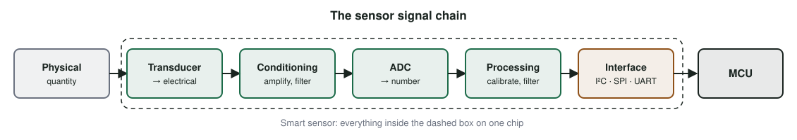

# Sensors {#sec-ch06}

::: {.callout-tip title="Learning objectives" appearance="simple"}
After this chapter you should be able to:

1. Describe the signal chain from a physical quantity to a number in software.
2. Explain what makes a sensor "smart", and why most modern sensors are.
3. Classify sensors along several dimensions and read the key specifications on a datasheet.
4. Distinguish accuracy, precision and resolution, and explain calibration and drift.
5. Read the kit's pressure/temperature sensor and inertial measurement unit, and convert raw readings to physical units.
6. Apply simple filtering and sampling rules to make sensor data trustworthy.
:::

## Why it matters

A modern smartphone contains more than a dozen sensors. A fitness band carries an accelerometer, a gyroscope, an altimeter, an optical heart-rate sensor, skin-temperature and ambient-light sensors, and a satellite-positioning receiver. A modern car has well over a hundred: cameras, ultrasonic parking sensors, wheel-speed sensors, seat-occupancy sensors that tune the airbags, battery-temperature sensors, tire-pressure sensors and more.

Sensing is what puts the "things" into the Internet of Things. Every decision a device makes, and every chart on a dashboard, is only as good as the sensor readings behind it. This chapter explains how sensors work, how to read their specifications, and how to turn raw readings into numbers you can trust.

## Concepts

### What a sensor does

A **sensor** detects a physical quantity, or a change in one, and produces a corresponding signal that another device can use. Sensors can measure almost anything: temperature, pressure, light, sound, motion, magnetic field, humidity, flow, distance, or chemical and biological properties.

The heart of every sensor is a **transducer**: an element whose electrical properties change with the quantity being measured. A thermistor's resistance changes with temperature; a photodiode's current changes with light; a tiny silicon structure flexes under acceleration and changes its capacitance.

Between the transducer and your code there is a **signal chain** (@fig-sensor-chain):

{#fig-sensor-chain width="100%"}

1. The **transducer** converts the physical quantity to an electrical quantity.
2. **Conditioning** circuits amplify and filter the signal and make it suitable for conversion.
3. An **ADC** converts it to a number (@sec-ch03).
4. **Processing** applies calibration, compensation and filtering.
5. An **interface** (I²C, SPI or UART, @sec-ch05) delivers the result to the microcontroller.

### Smart sensors

In the simplest sensors, such as a potentiometer or a thermistor, the microcontroller's own ADC does the conversion and your code does everything else. A **smart sensor** integrates the whole chain on one small chip, with its own ADC, a small processor and a digital interface. Smart sensors bring several advantages:

- **Self-calibration.** Factory calibration coefficients are stored in the chip, and the sensor or its driver applies them automatically.
- **Communication.** The sensor reports over a digital bus, which is far less sensitive to noise than a small analog voltage on a long wire.
- **Local computation.** Many smart sensors average, filter, detect events (a tap, a fall, a step) or raise an interrupt when a threshold is crossed, so the main processor can sleep.
- **Multi-sensing.** Several sensing elements share one package. The kit's MPU-6050 combines an accelerometer, a gyroscope and a temperature sensor.

Both of the kit's environmental and motion sensors, the BMP280 and the MPU-6050, are smart sensors on the I²C bus.

### Classifying sensors

Sensors can be grouped in several useful ways:

| Dimension | Options | Example |
|---|---|---|
| Power | **Active** (needs an external supply) or **passive** (generates its own signal) | A thermocouple is passive; an ultrasonic range finder is active |
| Intrusiveness | **Invasive** (part of the system it measures) or **non-invasive** | An implanted glucose sensor versus a camera |
| Contact | **Contact** or **non-contact** | A thermistor on a pipe versus an infrared thermometer |
| Reference | **Absolute** or **relative** (measured against a reference) | Absolute pressure versus differential pressure across a filter |
| Output | **Analog** or **digital** | A potentiometer versus the BMP280 |

### Common sensor types

| Sensor | Measures | Common technologies | Typical applications |
|---|---|---|---|
| Inertial (IMU) | Acceleration and rotation rate | MEMS accelerometers and gyroscopes | Activity tracking, drones, vibration monitoring |
| Tachometer | Rotational speed | Magnetic (Hall effect), optical | Motors, wheels, fans |
| Proximity | Presence of a nearby object | Capacitive, inductive, infrared, ultrasonic | Phones, parking aids, factory lines |
| Occupancy | People in a space | Passive infrared (PIR), ultrasonic, mm-wave radar | Lighting and HVAC control |
| Temperature / humidity | Heat, water vapor | Thermistor, RTD, thermocouple, solid-state | HVAC, cold chain, weather |
| Pressure | Force per area | Piezoresistive, capacitive MEMS | Weather, altitude, tire pressure |
| Light | Illuminance | Photoresistor, photodiode | Automatic lighting, display brightness |
| Soil moisture | Water content | Capacitive, resistive | Irrigation control |
| Touch / force | Contact and pressure | Capacitive, resistive, piezoresistive | User interfaces, pressure mats |
| Gas | Concentrations of CO₂, CO, VOCs | Metal-oxide, NDIR, electrochemical | Air-quality monitoring |

Most motion and pressure sensors today are **MEMS** (micro-electro-mechanical systems) devices: microscopic mechanical structures etched into silicon alongside their electronics. MEMS made precise motion sensing cheap enough for every phone and wearable.

### Reading a sensor's specifications

A datasheet describes a sensor with a handful of terms that are easy to confuse:

- **Range**: the minimum and maximum values the sensor can measure. The BMP280 measures 300 to 1100 hPa.
- **Resolution**: the smallest change the sensor can report. A 16-bit reading across a ±2 g range has a resolution of about 0.06 mg.
- **Accuracy**: how close a reading is to the true value.
- **Precision** (or repeatability): how close repeated readings of the same value are to each other.
- **Sensitivity**: how much the output changes for a given change in the input, such as 16 384 counts per g.
- **Offset (bias)**: the reading when the true input is zero.
- **Drift**: slow change of offset or sensitivity over time or temperature.
- **Noise**: random variation in readings, often given as a noise density or an RMS value.
- **Response time and sampling rate**: how quickly the sensor follows a change, and how often it can produce a reading.

A sensor can be precise but inaccurate (readings tightly clustered around the wrong value) or accurate on average but imprecise (readings scattered around the right value). High resolution does not imply high accuracy: a sensor can report many digits, all of them wrong.

**Calibration** measures a sensor's offset and sensitivity against a known reference and corrects for them. Many smart sensors ship with factory calibration; others, such as gyroscopes, need a quick calibration at start-up, for example by averaging readings while the device is held still.

### The kit's sensors

#### BMP280: pressure and temperature

The Bosch BMP280 measures barometric pressure and temperature [@bosch_bmp280]. On the kit it sits on the I²C bus at address 0x76. Internally it produces raw readings that must be combined with factory calibration coefficients stored in the chip. The Adafruit library handles this:

```cpp
#include <Wire.h>
#include <Adafruit_BMP280.h>

Adafruit_BMP280 bmp;

void setup() {
  Serial.begin(115200);
  Wire.begin(21, 22);
  if (!bmp.begin(0x76)) {
    Serial.println("BMP280 not found: check wiring and address");
    while (true) delay(1000);
  }
}

void loop() {
  float tempC = bmp.readTemperature();
  float hPa   = bmp.readPressure() / 100.0f;      // Pa → hPa
  float altM  = bmp.readAltitude(1013.25f);       // sea-level reference pressure
  Serial.printf("%.2f °C  %.2f hPa  %.1f m\n", tempC, hPa, altM);
  delay(1000);
}
```

Pressure falls by roughly 12 Pa for every meter of height near sea level, so a pressure sensor can estimate altitude:

$$
h \approx 44\,330 \left(1 - \left(\frac{p}{p_0}\right)^{1/5.255}\right)\ \text{m}
$$

where $p_0$ is the pressure at sea level. Because weather changes $p_0$ by tens of hectopascals, absolute altitude estimates are only rough unless you use the local sea-level pressure. *Changes* in altitude, such as climbing a flight of stairs, can be detected much more reliably, because the BMP280's relative accuracy is about ±0.12 hPa, or around ±1 m.

The temperature reading reflects the temperature of the chip, which is warmed slightly by its neighbors on the breadboard. Expect it to read a little above room temperature.

#### MPU-6050: acceleration and rotation

The InvenSense MPU-6050 is an **inertial measurement unit** (IMU) with a three-axis accelerometer and a three-axis gyroscope [@invensense_mpu6050]. On the kit it is at I²C address 0x68.

- The **accelerometer** measures acceleration, including gravity. Lying flat and still, it reads about +1 g on its Z axis and 0 g on X and Y. Its default range is ±2 g, with a sensitivity of 16 384 counts per g.
- The **gyroscope** measures the rate of rotation around each axis. Its default range is ±250 °/s, with a sensitivity of 131 counts per °/s.

Reading the MPU-6050 directly shows how a register-based smart sensor works. It starts in sleep mode, so the first step is to wake it by writing 0 to its power-management register. Then all six motion readings, plus temperature, can be read in one 14-byte burst starting at register 0x3B:

```cpp
#include <Wire.h>

constexpr uint8_t MPU = 0x68;

void writeReg(uint8_t reg, uint8_t value) {
  Wire.beginTransmission(MPU);
  Wire.write(reg);
  Wire.write(value);
  Wire.endTransmission();
}

void setup() {
  Serial.begin(115200);
  Wire.begin(21, 22);
  writeReg(0x6B, 0x00);                      // PWR_MGMT_1: wake up
}

void loop() {
  Wire.beginTransmission(MPU);
  Wire.write(0x3B);                          // ACCEL_XOUT_H
  Wire.endTransmission(false);               // repeated START
  Wire.requestFrom(MPU, (uint8_t)14);

  int16_t raw[7];                            // ax, ay, az, temp, gx, gy, gz
  for (int i = 0; i < 7; i++) {
    raw[i] = (Wire.read() << 8) | Wire.read();   // big-endian, two's complement
  }
  float ax = raw[0] / 16384.0f, ay = raw[1] / 16384.0f, az = raw[2] / 16384.0f;
  float gz = raw[6] / 131.0f;
  Serial.printf("a = (%.2f, %.2f, %.2f) g   gz = %.1f °/s\n", ax, ay, az, gz);
  delay(100);
}
```

From the accelerometer alone, the device's tilt can be estimated whenever it is not otherwise accelerating, because gravity then points straight down:

$$
\text{pitch} = \operatorname{atan2}\!\left(-a_x,\ \sqrt{a_y^2 + a_z^2}\right),\qquad
\text{roll} = \operatorname{atan2}(a_y,\ a_z)
$$

### Making readings trustworthy

#### Sampling

How often should you read a sensor? The **Nyquist criterion** says you must sample at more than twice the highest frequency present in the signal to capture it faithfully. Sampling too slowly causes **aliasing**: fast changes masquerade as slow ones. In practice, sample several times faster than the fastest change you care about. Room temperature changes over minutes; footsteps produce accelerations of a few hertz; machine vibration can reach kilohertz.

Sampling faster than necessary wastes energy and bandwidth, which matters for battery-powered devices.

#### Filtering

Real readings are noisy. Two simple filters cover most needs:

- A **moving average** of the last $N$ readings reduces random noise by about $\sqrt{N}$, at the cost of delay.
- An **exponential moving average** needs only one stored value:

  $$
  y_k = \alpha\, x_k + (1 - \alpha)\, y_{k-1},\qquad 0 < \alpha \le 1
  $$

  A small $\alpha$ smooths heavily but responds slowly; a large $\alpha$ follows changes quickly but passes more noise.

```cpp
float ema(float x) {
  static float y = NAN;
  constexpr float ALPHA = 0.2f;
  y = isnan(y) ? x : ALPHA * x + (1 - ALPHA) * y;
  return y;
}
```

#### Sensor fusion

Different sensors have complementary weaknesses. A gyroscope gives smooth, fast rotation estimates but drifts over time when integrated. An accelerometer gives a drift-free tilt reference but is disturbed by every bump. **Sensor fusion** combines them. The simplest example is a **complementary filter**:

$$
\theta_k = \beta\,(\theta_{k-1} + \omega_k\,\Delta t) + (1 - \beta)\,\theta_{\text{accel},k},\qquad \beta \approx 0.98
$$

It trusts the gyroscope over short time scales and the accelerometer over long ones. Phones, drones and wearables use more sophisticated versions, such as Kalman filters, but the idea is the same.

::: {.callout-tip title="Try it on your kit: from raw counts to physics"}
This exercise uses Stage 2 of the kit build.

1. Read the BMP280 for one minute and compute the mean and standard deviation of the pressure. Then lift the kit from the floor to a table. Can you see the change?
2. Read the MPU-6050 with the board flat and still. Which axis reads about 1 g? Compute the gyroscope's offsets by averaging 200 samples, and subtract them from later readings.
3. Tilt the board and print pitch and roll from the accelerometer. Now shake it gently. What happens to the tilt estimate?
4. Apply an exponential moving average to the pitch with α = 0.1 and α = 0.5. Describe the trade-off you see.
5. Optional: implement the complementary filter and compare it with the accelerometer-only estimate while shaking the board.
:::

## Design trade-offs

| Decision | Considerations |
|---|---|
| Analog vs. digital (smart) sensor | Analog sensors are cheap and simple but sensitive to noise and wiring; digital sensors are calibrated and robust but cost more and need a bus. |
| Sampling rate | Faster sampling captures more detail but costs energy, processing and bandwidth. |
| On-sensor vs. on-MCU processing | Event detection on the sensor lets the MCU sleep; processing on the MCU is more flexible. |
| Filtering | More smoothing means less noise but more delay. |
| Accuracy class | Better accuracy costs money and often power. Buy only the accuracy the application needs. |

## Common pitfalls

- **Trusting the first reading.** Many sensors need a short warm-up or settling time after power-up or after waking.
- **Forgetting to wake the sensor.** The MPU-6050 starts in sleep mode and returns zeros until it is woken.
- **Wrong byte order or sign.** The MPU-6050 sends 16-bit two's-complement values, high byte first.
- **Confusing resolution with accuracy.** Many digits do not mean a correct value.
- **Self-heating.** A temperature sensor next to a voltage regulator or a radio measures the board, not the room.
- **Integrating gyroscope data without correction.** The angle drifts without bound.
- **Unit mistakes.** Pa versus hPa, g versus m/s², degrees versus radians.

::: {.callout-note title="Advanced track" collapse="true"}
**Characterizing noise.** Log 10 000 gyroscope samples with the board still and plot their histogram and the Allan deviation. The Allan deviation separates white noise (which averaging removes) from bias instability (which it does not), and is the standard way to compare inertial sensors.

**Sensor-hub architectures.** Phones and wearables offload continuous sensing to a low-power sensor hub or to the sensor itself, so that the main processor can sleep. Modern IMUs such as the Bosch BMI270 or the ST LSM6DSO include step counters, gesture detectors and even small machine-learning cores. Compare the energy cost of counting steps on the MCU with counting them on the sensor.

**Calibration in the field.** Magnetometers need hard-iron and soft-iron calibration after they are mounted, because nearby metal and currents distort the field they measure. Research how a phone guides you through "figure-eight" calibration and what it is estimating.
:::

## Check your understanding

1. List the five stages of a sensor signal chain.
2. What makes a sensor "smart"? Give two advantages.
3. Explain the difference between accuracy, precision and resolution, using a dartboard analogy.
4. The MPU-6050 accelerometer reads 8 192 counts on its Z axis at the ±2 g range. What acceleration is that?
5. Why does a gyroscope-only angle estimate drift, and how does a complementary filter help?
6. You want to detect footsteps, which produce accelerations at up to about 5 Hz. What is the minimum sampling rate, and what would you choose in practice?
7. Your BMP280 reports an altitude of 140 m, but you know you are at 20 m. Give two likely reasons.

## Further reading

- Bosch Sensortec, *BMP280 datasheet* [@bosch_bmp280].
- InvenSense, *MPU-6000/MPU-6050 Product Specification* and *Register Map* [@invensense_mpu6050].
- J. Fraden, *Handbook of Modern Sensors* [@fraden_sensors], a comprehensive reference on sensing principles.
