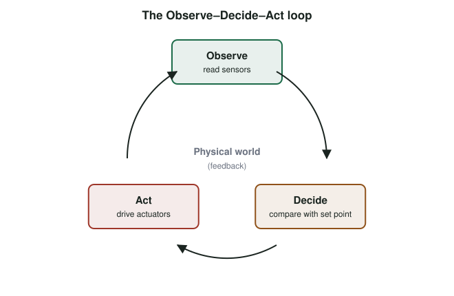

# Actuators and the Observe–Decide–Act Loop {#sec-ch07}

::: {.callout-tip title="Learning objectives" appearance="simple"}
After this chapter you should be able to:

1. Define an actuator and classify actuators by motion, output, power and energy type.
2. Explain the Observe–Decide–Act (ODA) loop and identify its parts in a real device.
3. Drive loads safely from a microcontroller, using transistors, separate supplies, diodes and capacitors where needed.
4. Control a hobby servo, a buzzer and a display from the ESP32.
5. Implement simple control strategies: on/off with hysteresis, and proportional control.
6. Choose safe default states for actuators when something fails.
:::

## Why it matters

Sensors let a device *observe* the world. Actuators let it *change* the world: open a valve, move a robot arm, sound an alarm, light a warning, or display a message. An IoT system that only senses is a monitoring system. One that also acts becomes a control system, and with that comes responsibility. A misread temperature produces a wrong chart; a misfired actuator can flood a basement or unlock a door.

This chapter covers the main families of actuators, how to drive them without damaging the microcontroller, and the decision loop that connects sensing to action.

## Concepts

### What an actuator is

An **actuator** converts a control signal, usually a small electrical signal or a digital command, plus a source of energy into a physical effect: motion, force, light, sound, heat or an image. Actuators are the natural complement to sensors. Many devices contain both: a smart thermostat senses temperature and drives a relay that turns the furnace on.

### The Observe–Decide–Act loop

IoT actuation follows a simple cycle, the **Observe–Decide–Act** (ODA) loop (@fig-oda):

{#fig-oda width="80%"}

1. **Observe**: read sensors, or receive data from other devices.
2. **Decide**: compare the observations with a goal (a **set point**) and choose an action. The decision can happen on the device, at a nearby gateway or in the cloud.
3. **Act**: drive the actuators. The action changes the physical world, which changes the next observation.

When the decision uses the result of earlier actions, the loop is a **closed-loop** (feedback) control system. A thermostat is closed-loop: it measures the temperature its furnace has produced. A lawn sprinkler on a timer is **open-loop**: it waters on schedule whether or not the soil is already wet.

Where the decision is made matters. A loop closed on the device can respond in milliseconds and keeps working when the network fails. A loop closed in the cloud can use more data and more computation, but inherits the network's delay and failures. @sec-ch18 returns to this choice.

### Classifying actuators

| Dimension | Options |
|---|---|
| Type of motion | None (static), linear, rotary; one, two or three axes |
| Output | **Binary** (on/off, open/closed) or **continuous** (position, speed, brightness) |
| Power | Micro-power (an LED), low power (a hobby servo), high power (an industrial motor) |
| Energy source | Electrical, hydraulic, pneumatic, thermal, manual |
| Application | Consumer, automotive, healthcare, industrial, agricultural |

Some binary actuators are **bistable**: they hold their last state without power. A latching relay or a latching solenoid valve stays where it was put, which saves energy in battery-powered devices but means a power failure leaves them in an unknown state.

### Families of actuators

- **Electric motors** convert electrical energy into rotation. *DC motors* spin continuously, with speed set by voltage or PWM. *Servo motors* add a gearbox, a position sensor and a controller so they move to a commanded angle. *Stepper motors* move in precise steps and hold their position without feedback.
- **Linear actuators** convert rotation into straight-line motion, typically with a lead screw.
- **Solenoids** are electromagnets that pull a metal plunger. They drive door locks and valves.
- **Relays** are switches operated by an electromagnet (or by a semiconductor, in solid-state relays). They let a low-power circuit switch a high-power one, such as a mains-powered heater.
- **Hydraulic actuators** use pressurized liquid. By Pascal's law, a pressure applied to a confined liquid is transmitted throughout it, so a small piston can drive a large one with great force. They power excavators and aircraft control surfaces.
- **Pneumatic actuators** use compressed air in the same way, trading force for speed and cleanliness. They are common in factory automation.
- **Non-mechanical actuators** produce information rather than motion: lights, displays and speakers.

### Non-mechanical actuators

#### Lights

LEDs are the most common actuator of all. They can be binary (a status light) or continuous (dimmed with PWM, @sec-ch03). A traffic light is a familiar example of a binary, stable-state output, and is the subject of [Lab 2](/part7-lab-companion/L2-traffic-controller.qmd).

#### Displays

A display converts electrical signals into an image. Common technologies are **LCD** (a backlight shining through liquid crystals), **OLED** (each pixel emits its own light, so black pixels use no power), **LED matrices**, and **e-paper** (which holds an image with no power at all, ideal for labels and signs that change rarely).

The kit's display is a 128 × 64-pixel monochrome OLED driven by an SSD1306 controller over SPI (@sec-ch05). Like most small displays, it keeps a frame buffer in the microcontroller's RAM: your code draws into the buffer, then sends the whole buffer to the display in one transfer.

```cpp
#include <SPI.h>
#include <Adafruit_GFX.h>
#include <Adafruit_SSD1306.h>
#include "iot_pins.h"

Adafruit_SSD1306 oled(128, 64, &SPI, IoTPins::OLED_DC, IoTPins::OLED_RES, IoTPins::OLED_CS);

void setup() {
  oled.begin(SSD1306_SWITCHCAPVCC);
  oled.clearDisplay();
  oled.setTextSize(2);
  oled.setTextColor(SSD1306_WHITE);
  oled.setCursor(0, 0);
  oled.println("Hello,");
  oled.println("IoT!");
  oled.display();                 // nothing appears until the buffer is sent
}

void loop() {}
```

#### Sound

A **speaker** moves a diaphragm with a coil in a magnetic field; it needs an amplifier to be driven from a microcontroller. A **piezo buzzer** is simpler: a ceramic disc that flexes when a voltage is applied. A *passive* piezo, like the kit's, makes a tone at whatever frequency you drive it with; an *active* buzzer contains its own oscillator and only beeps at one pitch.

```cpp
tone(IoTPins::BUZZER, 880, 200);   // 880 Hz for 200 ms (uses an LEDC channel)
```

### Driving loads safely

A microcontroller pin can supply only a few milliamperes at 3.3 V. Most actuators need more current, a higher voltage, or both. Connecting them directly damages the pin or resets the board. The standard techniques are:

- **Use a transistor or MOSFET as a switch.** The GPIO pin drives the transistor's input; the transistor switches the load's current from a separate supply. Logic-level MOSFETs are the usual choice for DC loads.
- **Use a separate supply for motors**, and **join the grounds**. The servo on the kit runs from its own 5 V rail fed from the board's VIN pin, which carries USB power before the 3.3 V regulator. The servo's signal wire still comes from a GPIO pin, so the two circuits must share ground.
- **Add a flyback diode across inductive loads.** Motors, relays and solenoids are coils. When the current through a coil is switched off, it produces a voltage spike that can destroy the transistor. A diode across the coil gives that energy a safe path.
- **Add a bulk capacitor near motors.** A servo draws large current pulses when it starts moving, which can make the supply voltage dip and reset the ESP32. The kit puts a 470 µF capacitor across the servo rail to supply those pulses locally.
- **Never connect the 5 V servo rail to the 3.3 V rail.** The ESP32's pins are not 5 V tolerant.

### Controlling a servo

A hobby servo reads a pulse every 20 ms (50 Hz). The **width** of the pulse sets the angle: typically about 1.0 ms for one end of the travel, 1.5 ms for the center and 2.0 ms for the other end, although many servos accept a wider range of roughly 0.5 to 2.5 ms. The ESP32's LEDC peripheral generates these pulses:

```cpp
// Arduino-ESP32 core 2.x API
constexpr int SERVO_CH = 2;           // channel 0 is used by tone()
constexpr int SERVO_HZ = 50;          // one pulse every 20 ms
constexpr int SERVO_BITS = 16;        // 65 536 steps per 20 ms period

void servoWriteUs(uint32_t us) {
  uint32_t duty = (uint32_t)((uint64_t)us * (1u << SERVO_BITS) / 20000u);
  ledcWrite(SERVO_CH, duty);
}

void servoWriteDeg(float deg) {
  deg = constrain(deg, 0.0f, 180.0f);
  servoWriteUs(500 + (uint32_t)(deg / 180.0f * 2000.0f));   // 0.5–2.5 ms
}

void setup() {
  ledcSetup(SERVO_CH, SERVO_HZ, SERVO_BITS);
  ledcAttachPin(IoTPins::SERVO, SERVO_CH);
  servoWriteDeg(90);                  // start at the center
}

void loop() {}
```

Libraries such as ESP32Servo wrap this, but writing it once shows that a servo command is nothing more than a carefully timed PWM signal.

### Deciding: simple control strategies

The "decide" step can be as simple as a threshold or as complex as a machine-learning model. Three strategies cover most IoT devices:

- **On/off control** switches the actuator fully on or off around a set point. Without care it **chatters**: a heater near its set point switches on and off many times a second. **Hysteresis** fixes this by using two thresholds: turn the heater on below 20.5 °C and off above 21.5 °C.

  ```cpp
  void controlHeater(float tempC) {
    static bool heaterOn = false;
    if (!heaterOn && tempC < 20.5f) heaterOn = true;
    if ( heaterOn && tempC > 21.5f) heaterOn = false;
    digitalWrite(HEATER_PIN, heaterOn ? HIGH : LOW);
  }
  ```

- **Proportional control** sets the output in proportion to the **error**, the difference between the set point and the measurement: $u = K_p\,(r - y)$. It responds smoothly, but alone it usually settles slightly off target.
- **PID control** adds an integral term, which removes that steady error, and a derivative term, which damps overshoot. PID controllers run inside most motors, drones and industrial processes.

Every control loop must also run **fast enough**: if the decision step is slower than the physical process it controls, the loop becomes sluggish or unstable.

### Fail-safe design

Before writing control code, decide what each actuator should do when something goes wrong: the sensor fails, the network drops, the firmware crashes or the power fails. A **fail-safe** state is one that causes the least harm. A heater should fail *off*; a door lock on a fire exit should fail *unlocked*; a pump protecting a basement from flooding might need to fail *on*. Watchdog timers, sensor plausibility checks and command timeouts are how software enforces those choices.

::: {.callout-tip title="Try it on your kit: an Observe–Decide–Act loop"}
This exercise corresponds to the Observe–Decide–Act lecture activity and uses Stage 3 of the kit build (the servo rail).

1. **Observe**: read the potentiometer and smooth it with an exponential moving average.
2. **Decide**: map the reading to a servo angle between 0° and 180°.
3. **Act**: move the servo, and show the angle on the OLED.
4. Add a rule: if the angle exceeds 150°, sound the buzzer and light LED 1. Add hysteresis so the alarm does not chatter near the threshold.
5. Unplug the potentiometer's wiper wire (with the USB cable disconnected first, then reconnect power). What does the servo do? Design a plausibility check and a fail-safe position for this case.
:::

## Design trade-offs

| Decision | Considerations |
|---|---|
| Servo vs. stepper vs. DC motor | Servos are simple for positions within 180°; steppers give precise open-loop positioning; DC motors give continuous rotation and speed. |
| Relay vs. MOSFET | Relays switch AC and isolate circuits but are slow, noisy and wear out; MOSFETs are fast, silent and efficient for DC loads. |
| Bistable vs. monostable | Bistable actuators save energy but have no natural fail-safe state on power loss. |
| Local vs. remote decisions | Local loops are fast and survive network failures; remote loops can use more data. |
| On/off vs. proportional control | On/off is simple and suits slow processes; proportional or PID control is needed for precise, fast processes. |

## Common pitfalls

- **Powering motors from a GPIO pin or the 3.3 V rail.** The board browns out and resets whenever the motor moves.
- **No common ground** between the motor supply and the microcontroller. The control signal has no reference.
- **No flyback diode** on relays and solenoids.
- **Forgetting `display()`** on the OLED: drawing commands only change the frame buffer.
- **PWM channel conflicts.** `tone()` and the servo fighting over the same LEDC channel or timer produce erratic movement.
- **Chattering** from on/off control without hysteresis.
- **No fail-safe state**, so a crash leaves an actuator in its last, possibly dangerous, position.

::: {.callout-note title="Advanced track" collapse="true"}
**Tuning a PID loop.** Build a simple closed loop in which the servo should point at a target angle measured by the MPU-6050 mounted on the servo horn. Implement proportional control, observe the steady-state error, then add integral and derivative terms. Document how you tuned $K_p$, $K_i$ and $K_d$, and what limited the loop's speed.

**Actuator safety standards.** Functional-safety standards such as IEC 61508 (general) and ISO 26262 (automotive) require a hazard analysis, defined safe states and evidence that the system reaches them. Choose an IoT actuator (a smart lock, a connected oven, an insulin pump) and write a one-page hazard analysis: what can go wrong, what is the safe state, and how is it enforced?
:::

## Check your understanding

1. Name the three steps of the ODA loop and give an example of each for a smart irrigation controller.
2. What is the difference between open-loop and closed-loop control?
3. Why does the kit's servo have its own 5 V rail and a 470 µF capacitor?
4. What pulse width would you send for a servo's center position, and how often?
5. Why must a relay coil have a flyback diode?
6. A heater controlled at exactly 21 °C switches on and off several times per second. What is happening, and how do you fix it?
7. What should a smart door lock do when its battery is about to run out? Justify your answer.

## Further reading

- K. J. Åström and R. M. Murray, *Feedback Systems* [@astrom_murray_feedback], a free textbook on control.
- Adafruit, *Adafruit GFX Graphics Library* guide [@adafruit_gfx], for drawing text and graphics on small displays.
