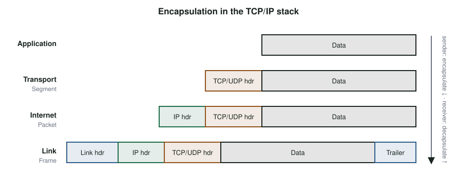

# Communication Models: OSI and TCP/IP {#sec-ch08}

::: {.callout-tip title="Learning objectives" appearance="simple"}
After this chapter you should be able to:

1. Explain what a network protocol is and why networks are organized in layers.
2. Describe the seven layers of the OSI model and the job of each.
3. Map the OSI model onto the four-layer TCP/IP model actually used on the internet.
4. Trace a message through encapsulation and decapsulation, naming the data unit at each layer.
5. Explain the four kinds of address in TCP/IP (physical, logical, port, name) and how NAT, DHCP and DNS use them.
6. Choose between TCP and UDP for an IoT application, and connect the ESP32 to a Wi-Fi network and a web server.
:::

## Why it matters

The serial buses in @sec-ch05 connect chips a few centimeters apart, on one board, under one controller. They cannot scale to billions of devices made by thousands of companies, spread across the planet and connected by every kind of medium from fiber to radio.

The internet solves that problem with **layering**: each layer provides one well-defined service to the layer above, and hides how it is done. A temperature reading from your kit can travel over Wi-Fi, Ethernet, fiber and a cellular link without your code knowing or caring. Understanding the layers is what lets you reason about where a problem is when "the device can't reach the server", and what lets you choose the right protocols for an IoT system in the chapters that follow.

## Concepts

### Protocols and layers

A **network protocol** defines the format and order of the messages exchanged between two or more communicating entities, and the actions taken when a message is sent or received, or when some other event happens (such as no reply arriving in time).

Human protocols work the same way. Taking a plane trip involves a sequence of layered steps: you buy a ticket, check your bag, pass security and board the plane; on arrival the steps run in reverse. Each step relies on the one below it and serves the one above. The ticket counter does not care how the plane flies.

Network designers organize protocols the same way, into a **protocol stack**. Each layer:

- offers a **service** to the layer above (for example, "deliver this message to that application");
- uses the service of the layer below;
- talks, conceptually, to the **same layer** on the other device, using that layer's protocol.

A layer can be implemented in hardware, in software, or in both.

### The OSI reference model

In the late 1970s and early 1980s, the International Organization for Standardization (ISO) defined the **Open Systems Interconnection** (OSI) model: seven layers meant to describe any communication system, independent of technology (@tbl-osi).

| # | Layer | Responsibility | Data unit | Examples |
|---|---|---|---|---|
| 7 | Application | Services to the user's application | Message | HTTP, MQTT, SMTP |
| 6 | Presentation | Translation, compression, encryption | Message | Character encoding, TLS (partly) |
| 5 | Session | Opening, managing and closing dialogs | Message | Session setup and checkpoints |
| 4 | Transport | Process-to-process delivery | Segment (TCP) / datagram (UDP) | TCP, UDP |
| 3 | Network | Host-to-host delivery across networks: logical addressing and routing | Packet | IPv4, IPv6 |
| 2 | Data link | Hop-to-hop delivery: framing, physical addressing, access to a shared medium | Frame | Ethernet, Wi-Fi MAC, BLE link layer |
| 1 | Physical | Moving individual bits over a medium | Bit | Voltages, light pulses, radio modulation |

: The seven layers of the OSI model. {#tbl-osi}

Some details of each layer:

- The **physical layer** defines connectors, cables, how bits are represented as signals, the data rate and the line configuration.
- The **data link layer** moves frames from one node to the next. It adds hardware (MAC) addresses, detects errors, and controls access to a shared medium so that devices do not all talk at once.
- The **network layer** delivers packets from the source host to the destination host, possibly across many networks. It provides logical addresses and **routing**.
- The **transport layer** delivers messages from one *process* to another. It adds **port numbers** to identify the application, and may provide segmentation and reassembly, flow control, error control and connection management.
- The **session layer** controls the dialog between two applications, keeping it open long enough to finish and closing it afterwards.
- The **presentation layer** makes data understandable: it translates between data representations, compresses data, and encrypts it.
- The **application layer** provides services that applications use directly, such as transferring web pages or publishing sensor readings.

### Encapsulation

As data moves down the stack on the sender, each layer adds its own **header** (and sometimes a trailer) carrying the information its peer needs. This is **encapsulation**. On the receiver, each layer reads and removes its header and passes the rest up: **decapsulation** (@fig-encapsulation).

{#fig-encapsulation width="90%"}

A useful end-to-end example: when you send an email, the application chooses a protocol (SMTP) and passes the message down; it is segmented by the transport layer, placed in packets by the network layer, framed by the data link layer and sent as bits by the physical layer. At every router along the way, the lower layers are unwrapped and rewrapped for the next link. At the destination, the layers are unwrapped in reverse until the message reaches the recipient's email application.

### TCP/IP: the internet that won

The OSI model was developed slowly, through committees that included large telephone companies and computer vendors. Meanwhile, researchers funded by the US Defense Advanced Research Projects Agency (DARPA) built a simpler, working protocol suite, **TCP/IP**, and released it freely. By the 1990s, TCP/IP had become the de facto standard, and "the Internet" meant the network of networks that runs it [@russell_internet_wasnt].

OSI survives as a **vocabulary**: engineers still say "a layer-2 switch" or "a layer-7 load balancer". The protocols in use, however, follow the four-layer TCP/IP model (@tbl-tcpip).

| TCP/IP layer | Corresponding OSI layers | Main protocols | Main device |
|---|---|---|---|
| Application | 5, 6, 7 | HTTP, MQTT, CoAP, DNS, TLS | End hosts |
| Transport | 4 | TCP, UDP | End hosts |
| Internet | 3 | IPv4, IPv6, ICMP | Routers |
| Link (network access) | 1, 2 | Ethernet, Wi-Fi, BLE, 802.15.4 | Switches, access points |

: The TCP/IP model and its relationship to OSI. {#tbl-tcpip}

TCP/IP has no separate session or presentation layers. If an application needs those services, such as encryption or compression, the application (or a library it uses, like TLS) provides them.

### Four kinds of address

TCP/IP uses four kinds of address, each solving a different problem:

1. **Physical (MAC) addresses** identify a network interface on one link, such as the ESP32's Wi-Fi interface (for example `24:6F:28:AB:CD:EF`). They are only meaningful on the local link, and **change at every hop** as a packet is re-framed.
2. **Logical (IP) addresses** identify a host on the internet, such as `192.168.0.17` (IPv4) or `2001:db8::17` (IPv6). They normally stay the same from source to destination.
3. **Port numbers** (16-bit, 0–65535) identify a process or service on a host. Process IDs cannot do this job: they are local to one machine, and two machines may use the same ones. Ports 0–1023 are reserved for **well-known services**: DNS on 53, HTTP on 80, HTTPS on 443. MQTT uses 1883, or 8883 with TLS.
4. **Names**, such as host names and URLs, are what people and configuration files use. The **Domain Name System** (DNS) translates names into IP addresses.

Why not use MAC addresses everywhere? MAC addresses are flat: they say nothing about where a device is. Routing on them would require every router to know the location of every device in the world. IP addresses are **hierarchical**: their prefix identifies a network, so a router only needs to know which way to send each network's traffic.

### How a device joins a network

When your ESP32 connects to Wi-Fi, three supporting protocols do work you never see:

- **DHCP** (Dynamic Host Configuration Protocol) gives the device an IP address, a subnet mask, a default gateway and DNS servers when it joins the network.
- **ARP** (Address Resolution Protocol) finds the MAC address that belongs to an IP address on the local network, so frames can be addressed. IPv6 uses Neighbor Discovery for the same job.
- **DNS** turns a name such as `broker.example.org` into an IP address.

### NAT

There are only about 4.3 billion IPv4 addresses, far fewer than the number of connected devices. Most homes and campuses therefore use **private addresses** inside their network (such as `192.168.x.x` or `10.x.x.x`) and a single public address on the router.

The router performs **network address translation** (NAT). When a device sends a packet out, the router replaces its private source address and port with the router's public address and a new port, and records the mapping in a translation table. When a reply arrives at that public port, the router looks up the table and forwards it to the right device.

NAT has a major consequence for IoT: **devices behind NAT can easily start connections outward, but nothing outside can start a connection to them.** This is why most IoT devices connect *out* to a cloud service or broker and keep that connection open, rather than running a server that the outside world connects to. IPv6, with its vast address space, removes the need for NAT, although firewalls usually still block unsolicited inbound connections.

### TCP and UDP

The transport layer offers two main services:

| | TCP | UDP |
|---|---|---|
| Connection | Connection-oriented (a handshake first) | Connectionless |
| Delivery | Reliable, in order, with retransmission | Best effort: datagrams may be lost, duplicated or reordered |
| Flow and congestion control | Yes | No |
| Header size | 20 bytes or more | 8 bytes |
| Typical IoT uses | HTTP, MQTT, firmware downloads | DNS, CoAP, time sync (NTP), streaming |

: Comparing the two main transport protocols. {#tbl-tcp-udp}

TCP's reliability costs time and energy: a connection needs a three-way handshake before any data flows, and every segment must be acknowledged. For a sensor that sends one small reading every ten minutes, UDP (often with a lightweight application-level acknowledgment, as in CoAP, @sec-ch12) can be far more efficient. For a firmware update, where every byte must arrive, TCP is the obvious choice.

### TCP/IP on the ESP32

The ESP32's Wi-Fi driver and the lwIP TCP/IP stack implement all four layers. From the Arduino framework, joining a network and making an HTTP request takes a few lines:

```cpp
#include <WiFi.h>
#include <HTTPClient.h>
#include "secrets.h"                     // WIFI_SSID, WIFI_PASSWORD, SERVER_BASE_URL

void setup() {
  Serial.begin(115200);
  WiFi.mode(WIFI_STA);                   // station (client) mode
  WiFi.begin(WIFI_SSID, WIFI_PASSWORD);  // link layer: associate with the access point
  while (WiFi.status() != WL_CONNECTED) {
    delay(250);
    Serial.print('.');
  }
  // DHCP has now given us an IP address, gateway and DNS server
  Serial.printf("\nIP %s  gateway %s  MAC %s  RSSI %d dBm\n",
                WiFi.localIP().toString().c_str(),
                WiFi.gatewayIP().toString().c_str(),
                WiFi.macAddress().c_str(),
                WiFi.RSSI());

  HTTPClient http;                                   // application layer
  http.begin(String(SERVER_BASE_URL) + "/ping");     // DNS lookup, TCP connect
  int status = http.GET();
  Serial.printf("HTTP status %d: %s\n", status, http.getString().c_str());
  http.end();
}

void loop() {}
```

Keep credentials in a separate `secrets.h` file that is excluded from version control.

::: {.callout-tip title="Try it on your kit: a classroom poll over HTTP"}
This exercise corresponds to the classroom-poll lecture activity. Your kit acts as an HTTP client and submits an answer to a poll server; the instructor's dashboard shows everyone's answers.

1. Connect to Wi-Fi and print your IP address, gateway, MAC address and signal strength. Which of these would change if you moved to a different building? Which would not?
2. Use the buttons to choose an answer and send it to the server with an HTTP POST. Show the server's response on the OLED.
3. For one request, identify what each TCP/IP layer contributes: the link (Wi-Fi), internet (IP addresses), transport (ports) and application (HTTP method, path, body).
4. Your kit has a private IP address. Explain how the server's reply finds its way back to it.

A guided, step-by-step version for a lecture session is [Activity 5](/part8-activities/A5-http-poll.qmd).
:::

## In depth (optional) {#sec-ch08-depth}

::: {.callout-note appearance="simple" icon=false}
**Optional, in-depth explanation.** This section goes beyond the rest of the chapter into the math and physics behind it. Nothing later in the book depends on it; skip it on a first reading.
:::

### Overhead and delay, counted

**How much of a message is payload?** Each layer adds its own header. Consider a 4-byte temperature reading sent in an HTTP POST over Wi-Fi with IPv4:

| Layer | Bytes added (typical) |
|---|---|
| HTTP request line and headers | ≈ 150 |
| TCP header | 20 (often 32 with options) |
| IPv4 header | 20 |
| 802.11 MAC header, LLC/SNAP, FCS | ≈ 36 |

The payload is 4 of roughly 230 bytes, an efficiency $\eta = \text{payload}/\text{total}$ under 2%. Before it, TCP's three-way handshake exchanged three more packets, and the response and connection teardown add more. For a 4-byte reading, protocol choice dominates the energy bill: Chapter 12 compares MQTT and CoAP, which shrink the application header to a few bytes and avoid a new connection per reading.

**Where the delay comes from.** The delay of one packet across one link is the sum of four parts:

$$
d = d_\text{proc} + d_\text{queue} + \underbrace{\frac{L}{R}}_{d_\text{trans}} + \underbrace{\frac{s}{v}}_{d_\text{prop}},
$$

where $L$ is the packet length in bits, $R$ the link rate, $s$ the distance and $v$ the signal speed (about $2\times10^8$ m/s in cable). A 230-byte frame at 1 Mb/s takes 1.8 ms to transmit; it travels 300 m of air in 1 µs. On short links, **transmission and queueing dominate**; across continents, propagation does (about 40 ms each way across the United States in fibre).

**Round trips set the floor.** A new HTTPS request needs one round trip for TCP's handshake, one for TLS 1.3's, and one for the request itself: at least three round-trip times (RTT). With a 50 ms RTT to a cloud region, the minimum is 150 ms before the server even processes the reading. Keeping connections open, or using UDP-based protocols, removes most of it.

**The bandwidth-delay product.** A sender can only keep a link busy if it has $R \times \text{RTT}$ bits in flight. At 10 Mb/s and 50 ms RTT that is 62.5 kB; a small device with a 4 kB TCP window gets at most $4096 \times 8 / 0.05 \approx 655$ kb/s, whatever the link speed.

**Exercise.** In Activity 5's extension you measured the POST round-trip time. Using the formula above, estimate how much of it is Wi-Fi transmission time, and suggest where the rest comes from.

Sources for this section: [@kurose_ross].

## Design trade-offs

| Decision | Considerations |
|---|---|
| TCP vs. UDP | Reliability and simplicity versus latency, overhead and energy |
| Device connects out vs. accepts connections | Outbound connections work through NAT and firewalls; inbound ones usually do not |
| IPv4 vs. IPv6 | IPv4 is universal but needs NAT; IPv6 gives every device an address and suits low-power networks (@sec-ch11) |
| Keep connections open vs. reconnect | Open connections give low latency for commands but use memory, and energy for keep-alives |

## Common pitfalls

- **Confusing MAC and IP addresses.** MAC addresses are local to a link; IP addresses are end to end.
- **Expecting to reach a device behind NAT from outside.** Design for outbound connections.
- **Hard-coding IP addresses.** Use names and DNS; addresses change.
- **Committing Wi-Fi passwords or API keys** to a public repository.
- **Blocking forever on the network.** Always set timeouts, and handle the case where Wi-Fi drops after it connected.
- **Enterprise Wi-Fi.** Campus networks often use WPA2-Enterprise (802.1X) or captive portals, which small devices cannot easily join. A dedicated IoT network or a travel router is often needed.

::: {.callout-note title="Advanced track" collapse="true"}
**Watching the layers.** Run Wireshark on a laptop connected to the same access point (or on a mirrored port) while your kit makes an HTTP request. Identify the DHCP exchange, the ARP request, the DNS query, the TCP three-way handshake, the HTTP request and response, and the TCP connection teardown. How many packets and bytes did it take to send a single poll answer?

**Overhead budget.** A sensor sends 20 bytes of data. Estimate the total bytes on the air for that reading when sent (a) as an HTTP POST over a new TCP connection, (b) as an MQTT publish over an existing connection, and (c) as a single UDP datagram. What does that imply for battery life?
:::

## Check your understanding

1. What does a protocol define?
2. Name the data unit at the transport, network and data-link layers.
3. Which OSI layers are combined into the TCP/IP application layer, and who provides their services?
4. Why can't the internet route on MAC addresses?
5. Which address changes at every hop, and which normally stays the same end to end?
6. Why do most IoT devices connect outward to a server instead of running a server themselves?
7. Give one IoT situation where UDP is a better choice than TCP, and one where it is not.
8. A file arrives corrupted. At which layers could error detection have caught it?

## Further reading

- A. Rayes and S. Salam [@rayes_salam_iot], chapter on the internet in IoT, whose sequence this chapter follows.
- J. F. Kurose and K. W. Ross, *Computer Networking: A Top-Down Approach* [@kurose_ross], the standard introduction to internet protocols.
- A. L. Russell, "OSI: The Internet that wasn't" [@russell_internet_wasnt], on how TCP/IP won.
