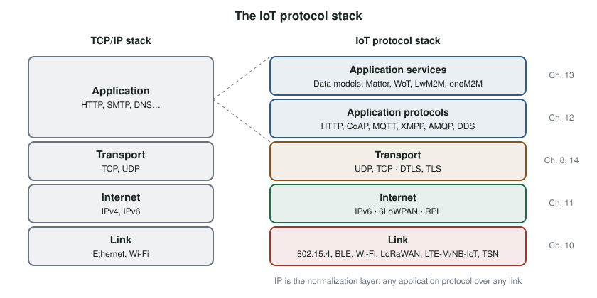

# IoT Network Requirements and the Protocol Stack {#sec-ch09}

::: {.callout-tip title="Learning objectives" appearance="simple"}
After this chapter you should be able to:

1. Explain why the traditional internet protocol stack is a poor fit for many IoT devices.
2. Classify constrained devices and describe the limits they place on protocols.
3. Describe the scalability challenges of addressing, credentials, control and radio spectrum.
4. Explain what deterministic networking means and when an IoT system needs it.
5. Summarize the security, privacy and interoperability requirements of IoT networks.
6. Draw the IoT protocol stack and place the main IoT protocols in it.
:::

## Why it matters

The TCP/IP stack was designed for computers with plenty of memory, wired connections and a person waiting at a screen. It works well for laptops and phones, and for an ESP32 on campus Wi-Fi. But many IoT devices are much smaller: a battery-powered sensor with 10 KB of RAM, a radio that can send only a few hundred bytes per second, and a duty cycle of a fraction of a percent. Others sit in factories or vehicles, where a message that arrives a few milliseconds late is as bad as one that never arrives.

This chapter sets out what IoT asks of a network, and introduces the layered protocol stack that the rest of Part III fills in.

## Concepts

### Requirement 1: support for constrained devices

The traditional internet assumes hosts with fast processors, large memories and mains power. Many IoT devices have none of these. RFC 7228 defines three classes of **constrained device** by their memory [@rfc7228]:

| Class | RAM (data) | Flash (code) | What it can run |
|---|---|---|---|
| Class 0 (C0) | ≪ 10 KB | ≪ 100 KB | Cannot run an IP stack securely; needs a gateway or proxy |
| Class 1 (C1) | ≈ 10 KB | ≈ 100 KB | A constrained IP stack with CoAP over UDP, but not HTTP and TLS comfortably |
| Class 2 (C2) | ≈ 50 KB | ≈ 250 KB | Most standard protocols, with care |

: Classes of constrained devices [@rfc7228]. {#tbl-rfc7228}

The ESP32, with 520 KB of RAM and megabytes of flash, is well beyond Class 2. But the coin-cell sensors, smart locks and wireless switches that make up much of the IoT are Class 0 or 1.

Energy is often a tighter limit than memory. A radio typically uses far more power than the processor, so every byte sent, every acknowledgment and every second spent listening costs battery life. Constrained devices therefore need protocols with small headers, few round trips, and support for **sleeping**, since a device that is asleep cannot answer a packet.

### Requirement 2: massive scalability

Tens of billions of devices stress the network in four ways.

**Addressing.** IPv4 has about 4.3 billion addresses, fewer than the number of IoT devices already deployed. Devices are hidden behind NAT and gateways (@sec-ch08), which works but makes them hard to reach directly. IPv6, with 128-bit addresses, can give every device its own globally unique address.

**Credentials and provisioning.** Every device needs network credentials and an identity, and nobody can configure billions of devices by hand. Many devices have no keyboard or screen. IoT systems need **zero-touch or low-touch provisioning**: automated ways to get credentials onto a device and register it with a service. Common approaches for Wi-Fi devices include:

- a **temporary access point**: the device starts its own Wi-Fi network and serves a configuration web page (the WiFiManager library does this on the ESP32);
- **BLE provisioning**: a phone app sends the credentials over Bluetooth Low Energy (ESP-IDF includes this);
- **QR codes** printed on the device, carrying a setup code that a phone app uses to commission it (Matter uses this, @sec-ch13).

**The control plane.** Network protocols can be divided into the **data plane**, which carries the messages themselves, and the **control plane**, which discovers the topology, reports link health, sets up and tears down sessions, maintains quality of service and reacts to faults. When a network grows from hundreds to millions of devices, the control plane must scale with it, without flooding the network with management traffic.

**Wireless spectrum.** Most IoT devices are wireless, and the radio spectrum is finite and shared. As devices multiply, and each sends more data, the unlicensed bands, especially 2.4 GHz where Wi-Fi, Bluetooth, Zigbee and Thread all live, become crowded. Spectrum is sometimes called the most valuable real estate nobody can see. Protocols must coexist, retransmit gracefully and stay quiet when they have nothing to say.

### Requirement 3: determinism

Many IoT applications only need data to arrive "soon". Some need it to arrive within a **guaranteed** time. A motion-control loop in a factory, a vehicle's braking system or a remote surgical robot fails if a packet is late.

A **deterministic network** is one where the worst-case latency and the **jitter** (variation in latency) of the messages that matter can be calculated in advance from a model of the network. Ordinary internet traffic is not deterministic: packets queue behind other traffic, and Wi-Fi devices wait for a quiet channel.

Achieving determinism requires precise **time synchronization** across devices, **scheduled** transmission slots, and **quality-of-service** reservations along the path. Standards such as IEEE **Time-Sensitive Networking** (TSN) for Ethernet and the IETF's **DetNet** bring these properties to IP-based networks, and the scheduled channel-hopping mode of IEEE 802.15.4 (TSCH) does the same for low-power wireless.

### Requirement 4: security and privacy

In 2016, the **Mirai** botnet scanned the internet for IoT devices, mostly cameras and video recorders running a stripped-down Linux, that still used factory-default usernames and passwords. It logged in, installed itself, and used hundreds of thousands of infected devices to launch distributed denial-of-service attacks. One attack on the DNS provider Dyn made many major websites unreachable for hours [@antonakakis_mirai].

Mirai used no clever exploit. It succeeded because the devices were exposed to the internet with default credentials and no way to update them. IoT networks need:

- **lightweight but strong cryptography** that constrained devices can run: AES for encryption, SHA-2 for hashing, elliptic-curve cryptography for keys and signatures, and a good random number generator. The ESP32 has hardware accelerators for AES, SHA, RSA and big-number arithmetic, and a hardware random number generator;
- **authentication and authorization** suited to devices without users;
- **privacy**, because IoT data often reveals personal behavior: when someone is home, how they sleep, where they drive. Identity management should allow devices and data to be decoupled from their owner's identity, while still letting the owner prove ownership.

Part IV covers these topics in depth.

### Requirement 5: application interoperability

Two devices can share a network and still fail to understand each other. A light switch from one company and a bulb from another may both speak IP, but unless they agree on what "turn on" looks like, they cannot cooperate. IoT needs agreement not only on how bytes move but on what they **mean**. @sec-ch13 is devoted to this problem.

### The IoT protocol stack

To meet these requirements, the IoT uses a variant of the TCP/IP stack (@fig-iot-stack). Two changes stand out.

{#fig-iot-stack width="100%"}

1. **The lower layers gain constrained options.** Alongside Wi-Fi and Ethernet, the link layer includes low-power radios such as Bluetooth Low Energy, IEEE 802.15.4 (used by Zigbee and Thread), LoRa and cellular IoT (LTE-M and NB-IoT). The internet layer adds **adaptation layers** such as 6LoWPAN, which compress IPv6 to fit small radio frames, and routing protocols designed for lossy networks, such as RPL.
2. **The application layer splits in two.**
   - **Application protocols** define how messages are exchanged: HTTP, CoAP, MQTT and others (@sec-ch12).
   - **Application services** define what the messages mean: common data models, device descriptions and interaction patterns, so that devices from different makers interoperate (@sec-ch13).

The IP layer in the middle acts as a **normalization layer**. As long as everything above and below speaks IP, any application protocol can run over any link technology, and each layer can evolve independently.

Not every IoT system uses IP end to end. Classic Bluetooth, LoRaWAN and Zigbee devices use their own stacks and reach the internet through a **gateway** that translates between them and IP. Newer standards, such as Thread, bring IPv6 all the way to the device.

::: {.callout-tip title="Try it on your kit: provisioning without hard-coded credentials"}
Until now your Wi-Fi password has been compiled into the firmware in `secrets.h`.

1. List three problems with hard-coding credentials in a product shipped to thousands of customers.
2. Add the WiFiManager library to a project. On first boot, the kit should start an access point; connect to it with your phone and enter your network's credentials. After a reset, it should reconnect automatically.
3. Where are the credentials stored now? Who could read them if they had the device in hand?
4. Add a "factory reset": holding both buttons at power-up erases the stored credentials.
:::

## Design trade-offs

| Requirement | Tension |
|---|---|
| Small headers and few round trips | Features such as reliability and security add bytes and exchanges |
| Long sleep periods | Reachability: a sleeping device cannot receive commands |
| End-to-end IP | Gateways and translation are simpler for very constrained devices |
| Determinism | Scheduling and synchronization add complexity and cost |
| Zero-touch provisioning | Convenience versus the risk of someone else claiming the device |

## Common pitfalls

- **Assuming every device can run TLS and HTTP.** Many cannot; choose protocols for the smallest device in the system.
- **Ignoring the cost of listening.** A radio that listens continuously can drain a battery faster than one that transmits occasionally.
- **Treating the 2.4 GHz band as empty.** In a dorm or office it is crowded; test in realistic conditions.
- **Shipping default passwords.** Mirai is the textbook consequence.
- **Designing provisioning last.** How a device gets its credentials shapes the whole user experience and much of its security.

::: {.callout-note title="Advanced track" collapse="true"}
**Energy budget.** A sensor runs on two AA cells (about 2 500 mAh). It sleeps at 10 µA and wakes once every 10 minutes for 2 s at 80 mA to read a sensor and transmit over Wi-Fi. Estimate the battery life. Then repeat the calculation for a LoRa radio that needs only 100 ms at 40 mA per transmission. What dominates the budget in each case?

**Reading an RFC.** Read the introduction and terminology sections of RFC 7228. Then classify three devices you know (for example a smart bulb, a fitness band and a parking sensor) and justify your classification.
:::

## Check your understanding

1. What makes a device "constrained", according to RFC 7228?
2. Name the four aspects of scalability discussed in this chapter.
3. Describe two ways to give a screenless Wi-Fi device its network credentials.
4. What is the difference between the control plane and the data plane?
5. Define a deterministic network. Give an IoT application that needs one and one that does not.
6. What did the Mirai botnet exploit, and what design practices would have prevented it?
7. Why does the IoT protocol stack split the application layer into two?
8. What role does IP play as a "normalization layer"?

## Further reading

- C. Bormann, M. Ersue and A. Keranen, RFC 7228, *Terminology for Constrained-Node Networks* [@rfc7228].
- M. Antonakakis et al., "Understanding the Mirai Botnet" [@antonakakis_mirai].
