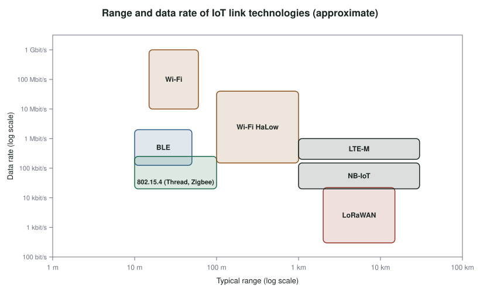

# The Link Layer: Short and Long Range {#sec-ch10}

::: {.callout-tip title="Learning objectives" appearance="simple"}
After this chapter you should be able to:

1. Explain why the link layer dominates an IoT device's energy budget, and estimate battery life from a duty cycle.
2. Use the ESP32's sleep modes to reduce power consumption.
3. Describe IEEE 802.15.4 and the protocols built on it, and compare star, mesh and cluster-tree topologies.
4. Describe Bluetooth Classic and Bluetooth Low Energy, including advertising and the GATT data model.
5. Describe Wi-Fi's role in IoT, including ESP-NOW and Wi-Fi HaLow.
6. Compare long-range options (LoRa and LoRaWAN, cellular IoT) and wired time-sensitive networking.
7. Choose a link technology for a given application from its range, data rate, power and cost.
:::

## Why it matters

The link layer is where an IoT device meets the physical world of radio waves and wires, and it is usually where most of the device's energy goes. Transmitting a packet over Wi-Fi can take more energy than a full second of computation; repairing lost transmissions with retries can account for most of the energy spent on communication.

There is no single best link technology. A wireless earbud, a smart lock, a soil sensor on a farm and a robot on a factory floor need very different combinations of range, data rate, latency, power and cost. This chapter surveys the main options and gives you a framework for choosing among them.

## Concepts

### What IoT asks of the link layer

Four groups of characteristics shape the choice of link technology:

- **Device characteristics.** How much energy the device has, and how much processing and memory it can spend on the radio stack. For many devices, communication costs more energy than everything else combined, so low-power radios are essential.
- **Traffic characteristics.** Some devices send short, occasional bursts (a door sensor); others send continuous streams (a camera). Some applications tolerate loss and delay (weather monitoring); others need guaranteed, bounded latency (engine control). The same device can face different requirements in different applications.
- **Access characteristics.** Wired or wireless, mobile or stationary, short range or long range.
- **Scalability characteristics.** Whether to build your own network (Wi-Fi, Zigbee, LoRa) or rent one (cellular), and whether to use a **star** topology, where every device talks to a central hub, or a **mesh**, where devices relay each other's traffic. Meshes extend coverage but add forwarding delay, and they converge more slowly as they grow.

### Energy and duty cycling

The ESP32 illustrates how much a radio costs and how sleep modes save it. Approximate figures for the ESP32 chip are [@espressif_esp32_datasheet]:

| Mode | What is running | Approximate current |
|---|---|---|
| Active, Wi-Fi transmitting | CPU and radio | 160–260 mA |
| Active, receiving or listening | CPU and radio | 80–90 mA |
| Modem sleep | CPU on, radio off between beacons | ≈ 3–20 mA |
| Light sleep | CPU paused (clock-gated), RAM kept | ≈ 0.8 mA |
| Deep sleep | Only the RTC domain and its memory | ≈ 10 µA |
| Hibernation | Only an RTC timer | ≈ 2.5 µA |

: ESP32 power modes. Figures are for the chip; a development board's USB bridge, regulator and LEDs add several milliamperes. {#tbl-esp32-power}

**Light sleep** uses **clock gating**: the clock is stopped to most of the chip, so its logic stops switching and stops consuming dynamic power, but its state is preserved. **Deep sleep** powers down the CPU, most of the RAM and the digital peripherals, leaving only the real-time-clock (RTC) controller, its peripherals and a small RTC memory. Waking from deep sleep is like a reset: `setup()` runs again. Variables marked `RTC_DATA_ATTR` survive.

```cpp
RTC_DATA_ATTR uint32_t bootCount = 0;      // kept in RTC memory across deep sleep

void setup() {
  Serial.begin(115200);
  bootCount++;
  Serial.printf("Boot #%lu: measure, transmit, sleep\n", bootCount);
  // ... read the sensor and send the reading here ...
  esp_sleep_enable_timer_wakeup(60ULL * 1000000ULL);   // wake in 60 s
  esp_deep_sleep_start();                              // never returns
}

void loop() {}                                         // never reached
```

Battery life follows from the **average** current:

$$
\text{battery life} = \frac{\text{capacity}}{I_{avg}},\qquad
I_{avg} = \sum_i I_i \cdot \frac{t_i}{T}
$$

For a 1 300 mAh battery:

- **Always active** at 250 mA: 1 300 / 250 ≈ **5.2 hours**.
- **Modem sleep**, active 50 ms of every second at 250 mA and in modem sleep (10 mA) the rest: $I_{avg} = 250 \times 0.05 + 10 \times 0.95 = 22$ mA, so about **59 hours**.
- **Hibernation**, active 4 ms of every second at 250 mA and hibernating at 2.5 µA the rest: $I_{avg} \approx 1.0$ mA, so roughly **54 days**.

The lesson is that battery life is set almost entirely by how long the radio is on. Sending less often, sending less data, and reconnecting quickly matter far more than optimizing code.

### IEEE 802.15.4: low-rate personal area networks

**IEEE 802.15.4** defines the physical and MAC layers for low-rate wireless personal area networks: low cost, low power and low data rate, with battery lives of months to years. Its main features are:

- operation in unlicensed bands: 868 MHz (Europe, one channel), 902–928 MHz (North America) and 2.4 GHz worldwide (16 channels at 250 kbit/s);
- ranges from tens of meters indoors to around a kilometer outdoors with line of sight;
- acknowledged frames for reliability, with frames of at most 127 bytes.

802.15.4 is the foundation for several complete stacks: **Zigbee** (widely used in lighting and home automation), **Thread** (an IPv6-based mesh used by Matter, @sec-ch13), **WirelessHART** and **ISA100.11a** (industrial), and **6LoWPAN** (@sec-ch11).

An 802.15.4 network has three kinds of device:

- a **coordinator**, the most capable node and the root of the network, which chooses the channel, assigns the network identifier and allocates addresses;
- **routers**, which relay traffic and buffer messages for sleeping devices;
- **end devices**, which know only enough to talk to their parent and can sleep most of the time.

These devices can be arranged in three topologies:

| Topology | Description | Strengths | Weaknesses | Typical use |
|---|---|---|---|---|
| Star | All devices talk to one coordinator | Simple and cheap; end devices can sleep | Single point of failure; range limited to one hop | Smart home, peripherals, health monitors |
| Mesh | Any device can relay for any other within range | Self-organizing and self-healing; multipath reliability | Forwarding delay; routers must stay awake | Agriculture, environmental monitoring, building automation |
| Cluster-tree | Hierarchical mesh; routers connect only through parents | Covers large areas with simple routing | Longer latency; less redundancy | Large sensor deployments |

: 802.15.4 topologies. {#tbl-topologies}

The **TSCH** (time-slotted channel hopping) mode, introduced in IEEE 802.15.4e, synchronizes all nodes to a shared schedule of time slots, and changes radio channel on every slot. Synchronization lets nodes sleep until their slot, which saves energy; channel hopping means interference on one frequency only affects some transmissions, which improves reliability. TSCH is the basis of deterministic low-power industrial networks.

### Bluetooth

**Bluetooth** (originally IEEE 802.15.1, now maintained by the Bluetooth SIG) operates in the 2.4 GHz band between 2 402 and 2 480 MHz. It uses **frequency hopping**: devices change channel up to 1 600 times per second, which reduces the impact of interference from Wi-Fi, microwave ovens and other devices sharing the band.

**Bluetooth Classic** (BR/EDR) organizes devices into **piconets**: one central device (historically called the master) and up to seven active peripherals that share its clock and hopping sequence. Piconets can be linked into larger **scatternets**. Classic Bluetooth suits continuous streams such as audio, but discovery and connection maintenance keep the radio busy, which limits battery life.

**Bluetooth Low Energy** (BLE), introduced in Bluetooth 4.0, is a separate, much simpler protocol designed for low power. Its main concepts are:

- **Advertising.** A device broadcasts short packets on three dedicated channels to announce itself. Beacons do nothing else; many sensors simply put their readings in their advertisements.
- **Connections.** A central device (such as a phone) can connect to a peripheral. Both then wake only at agreed **connection intervals**, typically every 7.5 ms to 4 s, and sleep in between.
- **GATT.** Connected devices exchange data through the **Generic Attribute Profile**. A peripheral exposes **services**, each containing **characteristics** (values with properties such as read, write and notify). Services and characteristics are identified by UUIDs; standard ones, such as the Heart Rate service, have short 16-bit UUIDs defined by the Bluetooth SIG.

Later versions added features important for IoT: Bluetooth 5 introduced a 2 Mbit/s mode and a long-range **coded PHY**; Bluetooth **Mesh** supports many-to-many networks; and Bluetooth 5.1 and later added direction finding and, more recently, channel sounding for distance measurement.

The original ESP32 supports Bluetooth 4.2, both Classic and BLE. A minimal BLE peripheral that exposes the potentiometer as a readable, notifying characteristic looks like this:

```cpp
#include <BLEDevice.h>
#include <BLEServer.h>
#include <BLE2902.h>
#include "iot_pins.h"

#define SERVICE_UUID "6e400001-b5a3-f393-e0a9-e50e24dcca9e"   // example custom UUIDs
#define POT_UUID     "6e400002-b5a3-f393-e0a9-e50e24dcca9e"

BLECharacteristic* potChar;

void setup() {
  BLEDevice::init("IoT-Kit");
  BLEServer* server = BLEDevice::createServer();
  BLEService* service = server->createService(SERVICE_UUID);
  potChar = service->createCharacteristic(
      POT_UUID, BLECharacteristic::PROPERTY_READ | BLECharacteristic::PROPERTY_NOTIFY);
  potChar->addDescriptor(new BLE2902());          // lets clients enable notifications
  service->start();
  BLEDevice::getAdvertising()->addServiceUUID(SERVICE_UUID);
  BLEDevice::startAdvertising();
}

void loop() {
  uint16_t value = analogRead(IoTPins::POT_ADC);
  potChar->setValue(value);                       // 2 bytes, little-endian
  potChar->notify();
  delay(500);
}
```

A generic BLE explorer app on a phone (such as nRF Connect) can now discover the kit, connect and subscribe to the value. @sec-lab-l4 builds a BLE step counter on this foundation.

### Wi-Fi

**Wi-Fi** (IEEE 802.11) offers high data rates and uses infrastructure that already exists in most buildings, which makes it the most common link for IoT devices with mains power [@iotanalytics_state_2025]. Its drawbacks for battery-powered devices are high transmit power, the time needed to associate and obtain an address, and the need to wake regularly to hear the access point's beacons.

Two variants address some of these drawbacks:

- **ESP-NOW** is a connectionless protocol from Espressif that sends short packets (up to 250 bytes) directly between ESP devices using the Wi-Fi radio, with no access point. It supports encrypted and unencrypted peers and delivery callbacks. It is ideal for simple device-to-device control, such as a remote button that switches a light, but it is proprietary and limited to a small number of encrypted peers.
- **Wi-Fi HaLow** (IEEE 802.11ah) moves Wi-Fi to the sub-GHz bands (902–928 MHz in the US) for longer range (around 1 km outdoors) and better penetration through walls. It supports thousands of stations per access point, longer sleep periods and smaller headers, with data rates from about 150 kbit/s to tens of Mbit/s.

Newer mainstream Wi-Fi standards also help IoT: Wi-Fi 6 (802.11ax) adds **target wake time**, which lets a device negotiate when it will next wake, so it can sleep through beacons.

### Long range: LPWANs

**Low-power wide-area networks** (LPWANs) trade data rate for range and battery life. They can reach several kilometers in cities and further in open country, with batteries lasting years, but they carry only a few bytes per message and a limited number of messages per day.

#### LoRa and LoRaWAN

**LoRa** is a radio modulation (the physical layer) developed by Semtech. It uses **chirp spread spectrum**: each symbol is a frequency sweep, which can be decoded even below the noise floor. Its key parameter is the **spreading factor** (SF7 to SF12). Each step up roughly doubles the time on air and adds range; SF7 at 125 kHz bandwidth carries about 5.5 kbit/s, while SF12 carries under 300 bit/s. In North America LoRa uses the 902–928 MHz band (US915), and in Europe the 863–870 MHz band (EU868), where regulations limit each device to a small duty cycle.

**LoRaWAN** is the MAC and network protocol built on LoRa, maintained by the LoRa Alliance [@lorawan_spec]. Its main features are:

- a **star-of-stars topology**: end devices transmit to any gateways in range; **gateways** are simple bridges that forward everything to a **network server**, which removes duplicates, manages devices and routes data to application servers. The intelligence is in the server, so devices stay simple;
- **device classes** that trade latency for energy: **Class A** devices listen only briefly after each uplink (lowest power); **Class B** devices also open scheduled receive windows; **Class C** devices listen continuously (mains-powered actuators);
- **adaptive data rate**, which picks the fastest spreading factor that reliably reaches a gateway;
- built-in **security**, with separate network and application session keys derived when a device joins (typically over the air, with OTAA).

The kit's RFM95W module (Semtech SX1276) speaks raw LoRa. Without a LoRaWAN network, two kits can talk directly, point to point:

```cpp
#include <SPI.h>
#include <LoRa.h>          // arduino-LoRa library
#include "iot_pins.h"

void setup() {
  Serial.begin(115200);
  LoRa.setPins(IoTPins::LORA_CS, IoTPins::LORA_RST, IoTPins::LORA_G0);
  if (!LoRa.begin(915E6)) {                // US915 band
    Serial.println("LoRa init failed: check wiring");
    while (true) delay(1000);
  }
  LoRa.setSpreadingFactor(7);
  LoRa.setSyncWord(0x34);                  // pick a team-specific value to avoid crosstalk
}

void loop() {
  LoRa.beginPacket();
  LoRa.print("beacon team-07 ");
  LoRa.print(millis() / 1000);
  LoRa.endPacket();                        // blocks until sent

  int size = LoRa.parsePacket();           // anything received?
  if (size) {
    String msg;
    while (LoRa.available()) msg += (char)LoRa.read();
    Serial.printf("RX '%s' RSSI %d dBm SNR %.1f dB\n",
                  msg.c_str(), LoRa.packetRssi(), LoRa.packetSnr());
  }
  delay(5000);
}
```

#### Cellular IoT

Cellular networks offer wide coverage without building infrastructure, at the cost of a subscription and higher module prices. Two standards are designed for IoT:

- **LTE-M** (LTE Cat-M1): up to about 1 Mbit/s, supports mobility and voice, suited to trackers and wearables.
- **NB-IoT** (narrowband IoT): tens of kbit/s, excellent building penetration, very low power, suited to static meters and sensors.

Both support **power saving mode** (PSM) and **extended discontinuous reception** (eDRX), which let a device sleep for hours while remaining registered. Many older devices rely on 2G and 3G networks, which carriers are shutting down; new designs should use LTE-M, NB-IoT or 5G variants such as RedCap.

#### Other LPWANs

**Sigfox** offered an ultra-narrowband network with a very small daily message allowance, and is now operated by UnaBiz. Other options include **Wi-SUN** (used by utilities for smart meters), **Wireless M-Bus** (metering in Europe) and **mioty**.

### Wired: time-sensitive networking

Not every IoT link is wireless. Factories and vehicles use Ethernet extended with IEEE **Time-Sensitive Networking** (TSN) standards. TSN combines:

- **precise time synchronization** (IEEE 802.1AS, a profile of the Precision Time Protocol) to better than a microsecond;
- **scheduled and shaped forwarding** (for example IEEE 802.1Qbv and 802.1Qav), so that time-critical traffic gets guaranteed, bounded latency even on links shared with video or file transfers;
- **stream reservation** and **redundant paths** (IEEE 802.1CB) for reliability.

Targets in industrial automation are on the order of microseconds of latency within a machine cell and around 100 µs across a factory.

### Choosing a link technology

@fig-range-rate places the main options by range and data rate.

{#fig-range-rate width="95%"}

| Technology | Typical range | Data rate | Power | Topology | Infrastructure |
|---|---|---|---|---|---|
| BLE | 10–50 m | 0.125–2 Mbit/s | Very low | Star, mesh | Phone or gateway |
| Zigbee / Thread (802.15.4) | 10–100 m per hop | 250 kbit/s | Very low | Mesh | Hub or border router |
| Wi-Fi | 30–50 m indoors | 10–1000+ Mbit/s | High | Star | Access point |
| Wi-Fi HaLow | up to ≈ 1 km | 0.15–80 Mbit/s | Low–medium | Star | HaLow access point |
| LoRaWAN | 2–15 km | 0.3–22 kbit/s | Very low | Star of stars | Gateways (own or community) |
| NB-IoT / LTE-M | Cellular coverage | 20 kbit/s–1 Mbit/s | Low | Star | Carrier, subscription |
| Ethernet + TSN | 100 m per segment | 100 Mbit/s–10 Gbit/s | Mains | Switched | Wired network |

: Comparing IoT link technologies. Values are typical, not limits. {#tbl-link-compare}

::: {.callout-tip title="Try it on your kit: a LoRa emergency beacon"}
This exercise corresponds to the LoRa lecture activity and uses Stage 4 of the kit build.

1. Agree on a sync word with a partner team and run the beacon sketch on both kits. Print each received message with its RSSI and SNR.
2. Walk one kit away from the other, down a corridor and through a door. At what RSSI and SNR do packets start to be lost?
3. Change the spreading factor from 7 to 10 on both kits. How do range and time on air change? Measure time on air with `micros()` around `endPacket()`.
4. Turn the beacon into an emergency beacon: pressing a button sends an alert that the other kit shows on its OLED and announces with the buzzer.
5. Estimate battery life for a beacon that wakes from deep sleep once per minute, sends one SF7 packet and goes back to sleep.
:::

## Design trade-offs

| Decision | Considerations |
|---|---|
| Range vs. data rate vs. power | You can usually have two of the three |
| Own network vs. carrier network | Building your own avoids subscription fees but requires deploying and maintaining gateways |
| Star vs. mesh | Stars are simple and let end devices sleep; meshes extend coverage but need always-on routers |
| Licensed vs. unlicensed spectrum | Licensed (cellular) bands are managed and predictable; unlicensed bands are free but shared |
| Standard vs. proprietary | Standards (BLE, Thread, LoRaWAN) bring interoperability; proprietary protocols (ESP-NOW) can be simpler but lock you in |

## Common pitfalls

- **Estimating battery life from the chip's datasheet only.** Regulators, USB bridges, LEDs and sensors on the board often draw more than the chip in deep sleep.
- **Ignoring retransmissions.** Lost packets cost energy twice.
- **Using a European LoRa frequency in the US**, or vice versa. Hardware and frequency plans are regional.
- **Exceeding duty-cycle or dwell-time limits** in unlicensed bands, which can make a device illegal to operate.
- **Operating a LoRa module without an antenna.** It can damage the transmitter.
- **Relying on 2G/3G modules** in new designs.
- **Testing radios only on a desk.** Walls, people, metal and other radios change everything.

::: {.callout-note title="Advanced track" collapse="true"}
**Link budget.** A link works if transmit power plus antenna gains, minus path loss, exceeds the receiver's sensitivity by a margin. With free-space path loss $\text{FSPL(dB)} = 20\log_{10}(d) + 20\log_{10}(f) - 147.55$ (meters and hertz), compute the free-space range of a 915 MHz LoRa link with +14 dBm transmit power, 0 dBi antennas and −130 dBm sensitivity. Then explain why real-world range is far shorter.

**LoRaWAN on campus.** Community networks such as The Things Network provide free LoRaWAN gateways in many cities. Register a device, join it over the air with OTAA, and compare the effort and the result with the point-to-point exercise above. What do you gain from the network server?

**Coexistence.** Wi-Fi channel 1, BLE advertising channels and Thread channel 11 all overlap near 2.4 GHz. Design a test that measures BLE packet loss while a nearby laptop streams video over Wi-Fi, and propose mitigations.
:::

## Check your understanding

1. Why is the link layer often responsible for most of an IoT device's energy use?
2. A device draws 200 mA for 100 ms every 10 s and 20 µA the rest of the time. What is its average current, and how long will a 2 000 mAh battery last?
3. What is preserved in ESP32 deep sleep, and how does the program resume?
4. Name the three device roles in an 802.15.4 network and what each does.
5. What advantages does TSCH bring to 802.15.4?
6. What are BLE services and characteristics? How does a phone receive updates from a characteristic without polling it?
7. Why is LoRaWAN called a "star of stars"? Where is the intelligence?
8. Choose a link technology for: (a) a water meter in a basement; (b) a wireless light switch in an apartment; (c) a livestock tracker on a ranch; (d) a security camera. Justify each.

## Further reading

- Espressif, *ESP-IDF Sleep Modes* documentation [@espressif_idf_sleep].
- K. Townsend et al., *Getting Started with Bluetooth Low Energy* [@townsend_ble].
- LoRa Alliance, *LoRaWAN Specification* [@lorawan_spec].
