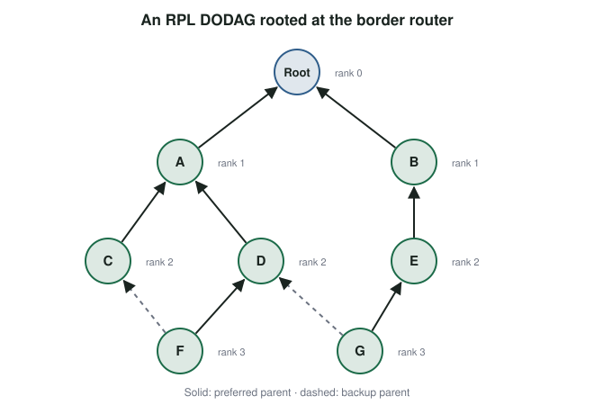

# The Internet Layer: 6LoWPAN and RPL {#sec-ch11}

::: {.callout-tip title="Learning objectives" appearance="simple"}
After this chapter you should be able to:

1. Explain the benefits of IP-based connectivity over proprietary networks for IoT.
2. Describe IPv6 addressing and autoconfiguration.
3. Define a low-power and lossy network (LLN) and the five challenges it poses for the internet layer.
4. Explain how 6LoWPAN fits IPv6 into small radio frames through compression, fragmentation and forwarding.
5. Describe how RPL builds and maintains routes in an LLN.
6. Explain the role of a border router, and how Thread brings these ideas to products.
:::

## Why it matters

Early sensor networks and home-automation systems used proprietary protocols. Each vendor's devices formed an island, reachable from the internet only through that vendor's gateway, which translated every message. When the vendor changed its product line or went out of business, the island was stranded.

The alternative is to make IoT devices **first-class citizens of the internet**, with their own IP addresses, so that the same open, long-lived standards, tools and skills work everywhere. The obstacle is that IP was designed for links with large frames and reliable delivery, and for hosts that never sleep. This chapter shows how two IETF standards, 6LoWPAN and RPL, adapt IPv6 to the smallest and least reliable networks.

## Concepts

### Why IP for IoT?

Moving from proprietary protocols to IP-based connectivity brings:

- **Open, long-lived standards**, maintained by the IETF and implemented by many vendors;
- **A familiar model** with decades of tools, documentation and trained engineers;
- **Transparent internet integration**: no protocol translation at the gateway, so end-to-end data flows and end-to-end security become possible;
- **Maintainability**: the same diagnostic tools (ping, traceroute, packet capture) work everywhere;
- **Global scalability**, given enough addresses, which means IPv6.

### The internet layer, briefly

Recall from @sec-ch08 that the internet layer delivers packets from a source host to a destination host across many networks. Routers **forward** each packet toward its destination using a routing table, and **routing protocols** build those tables by exchanging information about network links. On the wider internet, routing protocols such as OSPF (within an organization) and BGP (between organizations) do this job.

### IPv6 in a nutshell

**IPv6** uses 128-bit addresses, written as eight groups of four hexadecimal digits, with leading zeros dropped and one run of zero groups replaced by `::`. For example, `2001:0db8:0000:0000:0000:0000:0000:0017` becomes `2001:db8::17`.

Typically, the first 64 bits are a **network prefix** and the last 64 bits an **interface identifier**. Several features make IPv6 attractive for IoT:

- **Enough addresses** for every device to have a globally unique one, without NAT.
- **Stateless address autoconfiguration** (SLAAC): a device can build its own address from the prefix advertised by a router plus an interface identifier, with no DHCP server.
- **Link-local addresses** (starting `fe80::`) that every interface creates automatically, so devices on the same link can talk with no configuration at all.
- **A simpler, fixed 40-byte header**, with options moved into extension headers.
- **Neighbor Discovery**, which replaces ARP, finds routers and detects duplicate addresses.

### Low-power and lossy networks

Many IoT deployments form **low-power and lossy networks** (LLNs): networks of hundreds or thousands of constrained devices (@sec-ch09) connected by links where packet loss is high and variable, such as 802.15.4, BLE or low-power Wi-Fi. LLNs appear in building automation (heating, lighting, access control and fire systems), connected homes, healthcare, environmental monitoring and urban networks such as smart grids.

LLNs pose five challenges for the internet layer:

1. **Very little state.** Nodes have tiny memories, so routing protocols must keep as little per-node state as possible. A protocol that stores a full map of the network on every node will not fit.
2. **Sleeping nodes.** Nodes save energy by sleeping for long periods, so from the network's point of view the topology changes constantly.
3. **Varied traffic patterns.** Traffic can be point-to-point, point-to-multipoint (a controller commanding many lights) or multipoint-to-point (many sensors reporting to one collector), and both unicast and multicast must be supported.
4. **Small frames.** Link technologies such as 802.15.4 carry at most 127 bytes per frame, while IPv6 requires links to carry packets of at least 1 280 bytes.
5. **Unreliable links**, whose loss rates change over time with interference, weather and moving objects.

### 6LoWPAN: IPv6 over small frames

**6LoWPAN** (IPv6 over Low-Power Wireless Personal Area Networks) is an **adaptation layer** between the link layer and IPv6 [@rfc4944; @rfc6282]. It was designed for 802.15.4 and later adapted to BLE, DECT ULE and other links.

The size problem is stark. Of the 127 bytes in an 802.15.4 frame, the MAC header can take up to 25 bytes and link-layer security up to 21, leaving about 81. An uncompressed IPv6 header takes 40 of those and a UDP header another 8, leaving only about 33 bytes for application data.

6LoWPAN provides three functions:

1. **Header compression.** Most IPv6 header fields are predictable in an LLN: the version is always 6, hop limits and traffic classes take common values, and the addresses can usually be derived from the link-layer addresses already in the frame. 6LoWPAN's IPHC encoding replaces these fields with a few bits, compressing the 40-byte IPv6 header to as little as **2 bytes**. The UDP header can be compressed similarly, to as little as 4 bytes.
2. **Fragmentation and reassembly.** When a packet does not fit in one frame, 6LoWPAN splits it into fragments with small headers and reassembles it at the other end, so that IPv6's 1 280-byte minimum is met.
3. **Forwarding** across multiple hops. In **mesh-under** forwarding, the adaptation layer relays frames hop by hop, and the whole mesh looks like one IP link. In **route-over** forwarding, each hop is an IP router, and a routing protocol such as RPL decides the path.

A 6LoWPAN network connects to the rest of the internet through a **border router** (also called an edge router), which translates between compressed 6LoWPAN packets on the radio side and ordinary IPv6 packets on the Ethernet or Wi-Fi side. Because addresses and semantics are preserved, this is *adaptation*, not protocol translation: a server on the internet sees ordinary IPv6 packets from each sensor's own address.

### RPL: routing in lossy networks

**RPL** (pronounced "ripple"), the IPv6 Routing Protocol for Low-Power and Lossy Networks, is the IETF's standard routing protocol for LLNs [@rfc6550].

RPL is a **distance-vector** protocol. Unlike **link-state** protocols such as OSPF, which keep a database of the entire network on every node, a distance-vector node keeps only a little information about its neighbors and their distance to a destination. This fits the "very little state" constraint.

RPL organizes the network as a **destination-oriented directed acyclic graph** (DODAG): a tree-like structure rooted at the border router, in which every node points toward the root through one or more **parents** (@fig-rpl).

{#fig-rpl width="70%"}

The DODAG is built with a few control messages:

- The root broadcasts a **DIO** (DODAG Information Object), announcing the graph and its own **rank** (its position in the graph).
- Each node that hears DIOs chooses a **preferred parent** using an **objective function** and computes its own rank, which must be greater than its parent's. It then sends its own DIOs, so the graph spreads outward.
- A new node can ask for DIOs with a **DIS** (DODAG Information Solicitation).
- To make *downward* routes possible, nodes send **DAO** (Destination Advertisement Object) messages toward the root. In **storing mode**, intermediate routers remember downward routes; in **non-storing mode**, only the root does, and it places the full route in the packet header (source routing), which saves memory in the nodes.

The **objective function** defines what "best" means. Common choices minimize hop count (OF0) or the **expected transmission count** (ETX), the average number of transmissions needed to deliver a packet over each link (MRHOF). Other metrics include latency and remaining node energy.

Two properties make RPL suitable for lossy links:

- It is **proactive**: it builds and maintains routes before they are needed, and nodes can keep backup parents, so alternative paths exist before a failure.
- It is **under-reactive**: when a link fails, a node simply switches locally to another parent, instead of triggering a network-wide recomputation.

To keep control traffic low, RPL sends DIOs on a **Trickle timer**: frequently when the network is changing, and exponentially less often when it is stable.

### Thread: putting it together

**Thread** is a complete IPv6 mesh networking stack for homes and buildings, maintained by the Thread Group. It runs on 802.15.4 radios, uses 6LoWPAN for adaptation, adds its own mesh routing and secure commissioning, and connects to Wi-Fi or Ethernet through **border routers**, which are often built into smart speakers, hubs and TVs. Thread is one of the main transports for Matter (@sec-ch13).

The original ESP32 in your kit has no 802.15.4 radio, so it cannot join a 6LoWPAN or Thread network directly. Newer Espressif chips such as the ESP32-C6 and ESP32-H2 do have 802.15.4 radios and support Thread through the OpenThread stack, and dedicated 802.15.4 modules are also available.

### Mobility and security at the internet layer

- **Mobility.** When a device moves between networks, its IP address changes and its connections break. Mobile IPv6 lets a device keep a permanent home address while it roams, with a home agent forwarding traffic. In practice, most IoT systems avoid the problem by having devices reconnect and re-register with a cloud service from wherever they are.
- **Security.** IPsec can protect traffic at the internet layer, but it is heavy for constrained nodes. LLNs usually rely on **link-layer encryption** (802.15.4 includes AES-CCM) combined with security at the transport or application layer, such as DTLS or OSCORE (@sec-ch12, @sec-ch14).

::: {.callout-tip title="Try it on your kit: IPv6 on Wi-Fi"}
Although the kit cannot run 6LoWPAN, its Wi-Fi interface can run IPv6.

1. Enable IPv6 before connecting (`WiFi.enableIpV6()` in the Arduino-ESP32 2.x core; `WiFi.enableIPv6()` in 3.x) and print the link-local address after connecting. How was its interface identifier derived?
2. If your network advertises a global IPv6 prefix, print the global address as well. Is there a NAT between the kit and the internet now?
3. Calculate how many bytes of application payload remain in one 802.15.4 frame (a) without compression and (b) with IPv6 and UDP headers compressed to 2 and 4 bytes respectively, assuming a 25-byte MAC header and 21 bytes of security.
4. Sketch the DODAG that RPL would build for a building with sensors on three floors and a border router in the basement. Which nodes need to stay awake?
:::

## Design trade-offs

| Decision | Considerations |
|---|---|
| End-to-end IPv6 vs. gateway translation | IPv6 enables end-to-end flows and security; gateways allow simpler devices and proprietary radios |
| Mesh-under vs. route-over | Mesh-under hides the mesh from IP; route-over lets each hop make IP routing decisions |
| RPL storing vs. non-storing mode | Storing mode spends router memory to save header space; non-storing mode does the opposite |
| Hop count vs. ETX | Fewer hops is simple; ETX finds more reliable paths that may be longer |
| Thread vs. Zigbee | Thread is IP-native and part of Matter; Zigbee has a very large installed base |

## Common pitfalls

- **Assuming 802.15.4 frames carry IPv6 directly.** They cannot without 6LoWPAN.
- **Ignoring fragmentation costs.** Losing one fragment loses the whole packet; keep application messages small enough to fit in one frame.
- **Forgetting the border router.** An LLN without one is an island.
- **Expecting IPv4 tools to work unchanged.** Many IoT IPv6 addresses are link-local and need a zone (interface) identifier, as in `fe80::1%wlan0`.
- **Assuming IP connectivity means interoperability.** Devices must also agree on application protocols and data models (@sec-ch12, @sec-ch13).

::: {.callout-note title="Advanced track" collapse="true"}
**Simulating an LLN.** Contiki-NG and RIOT include 6LoWPAN and RPL implementations, and the Cooja simulator can run hundreds of virtual nodes. Simulate a 30-node RPL network, kill the root's busiest child, and measure how long the network takes to reconverge and how many control messages it sends.

**Reading IPHC.** Using RFC 6282, decode the two-byte IPHC header `0x7A33`. Which IPv6 fields are elided, which are carried inline after it, and where does the receiver get each elided value from? (Answer check: the traffic class, flow label, hop limit and both addresses are elided; only the next-header field is carried inline.)

**Comparing routing.** Thread does not use RPL; it uses its own distance-vector protocol with a small number of routers (up to 32) and a leader. Compare its design with RPL's in terms of state, scale and behavior when a router fails.
:::

## Check your understanding

1. Give three advantages of IP-based connectivity over proprietary IoT networks.
2. How does a device configure an IPv6 address without a DHCP server?
3. List the five challenges LLNs pose for the internet layer.
4. Why can't an uncompressed IPv6 packet be sent directly over 802.15.4?
5. Name the three main functions of 6LoWPAN.
6. What does a border router do, and why is that not "protocol translation"?
7. What is a DODAG, and what determines a node's rank?
8. Explain what it means for RPL to be proactive and under-reactive.

## Further reading

- Z. Shelby and C. Bormann, *6LoWPAN: The Wireless Embedded Internet* [@shelby_6lowpan].
- RFC 6550, *RPL: IPv6 Routing Protocol for Low-Power and Lossy Networks* [@rfc6550].
- RFC 6282, *Compression Format for IPv6 Datagrams over IEEE 802.15.4-Based Networks* [@rfc6282].
