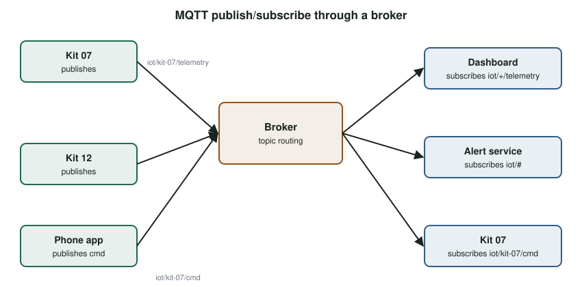

# Application Protocols: HTTP, CoAP, MQTT and More {#sec-ch12}

::: {.callout-tip title="Learning objectives" appearance="simple"}
After this chapter you should be able to:

1. Distinguish request/response from publish/subscribe interaction, and explain when each fits.
2. Use HTTP and REST from an IoT device, and explain HTTP's costs for constrained devices.
3. Describe CoAP's message model, reliability mechanism, observation and proxying.
4. Describe MQTT's broker architecture, topics, quality-of-service levels, retained messages and wills.
5. Recognize where XMPP, AMQP, DDS and others fit.
6. Choose an application protocol and payload format for a given IoT application.
:::

## Why it matters

Once a device has an IP address and a transport, it still needs a way to exchange meaningful messages with other devices and services. Should a thermostat wait to be asked for the temperature, or announce it whenever it changes? Should a light accept commands directly, or should commands pass through a central server? What happens to a command sent while the light's radio is asleep?

Application protocols answer these questions, and the right choice affects battery life, latency, reliability and how easily the system scales. This chapter covers the three protocols you will meet most often in IoT, HTTP, CoAP and MQTT, and places the others in context.

## Concepts

### Two interaction patterns

**Request/response.** A client sends a request to a server and waits for a response. The web works this way. It is simple and familiar, but the client must know the server's address, the server must be reachable, and getting updates means asking repeatedly (**polling**), which wastes energy and bandwidth when nothing has changed.

**Publish/subscribe** (pub/sub). Senders (**publishers**) send messages labeled with a **topic** to an intermediary, a **broker**. Receivers (**subscribers**) tell the broker which topics they want, and the broker forwards matching messages. Publishers and subscribers do not need to know about each other, do not need to be online at the same time (with the right settings), and can be added or removed freely. This **decoupling** suits IoT, where many sensors produce data for many consumers.

### HTTP and REST

**HTTP** is the web's application protocol, standardized by the IETF. It is text-based, request/response, and runs over TCP (or, in HTTP/3, over QUIC on UDP). Its design follows the **REST** (Representational State Transfer) architectural style, in which:

- every **resource** has a URI, for example `/devices/kit-07/temperature`;
- a small set of **methods** act on resources: `GET` (read), `POST` (create or submit), `PUT` (replace), `PATCH` (modify) and `DELETE`;
- **status codes** report outcomes: `200 OK`, `201 Created`, `400 Bad Request`, `401 Unauthorized`, `404 Not Found`, `500 Internal Server Error`;
- each request is **self-contained** (stateless), which makes servers easy to scale.

From the ESP32, posting a JSON reading takes a few lines:

```cpp
#include <WiFiClientSecure.h>
#include <HTTPClient.h>

void postReading(float tempC) {
  WiFiClientSecure tls;
  tls.setCACert(ROOT_CA_PEM);                       // verify the server's certificate
  HTTPClient http;
  http.begin(tls, "https://api.example.org/v1/readings");
  http.addHeader("Content-Type", "application/json");
  String body = String("{\"device\":\"kit-07\",\"temp_c\":") + tempC + "}";
  int code = http.POST(body);
  Serial.printf("POST -> %d\n", code);
  http.end();
}
```

HTTP's strengths are universality: every cloud service, programming language and firewall understands it. Its costs for constrained devices are:

- verbose, text-based headers, often hundreds of bytes per request;
- TCP and TLS handshakes before each new connection, which cost several round trips and significant energy;
- no built-in way for a server to push data to a device, other than polling, long polling, WebSockets or server-sent events.

HTTP is a good fit for mains-powered devices, for occasional uploads, and for talking to cloud APIs. It is a poor fit for battery-powered sensors on lossy networks.

### CoAP: REST for constrained devices

The IETF's CoRE (Constrained RESTful Environments) working group designed the **Constrained Application Protocol** (CoAP) to bring the REST model to devices and networks that cannot afford HTTP [@rfc7252]. CoAP keeps HTTP's concepts (URIs, methods, response codes, content types) but changes almost everything underneath:

- It runs over **UDP** (with DTLS for security), avoiding TCP's connection setup.
- Its **binary header** is only 4 bytes, followed by a token and compact options. A typical request fits in a few dozen bytes.
- It supports **multicast**, for example to discover all lights on a network at once.
- It is **asynchronous**: requests and responses are matched by a **token**, not by a connection.

#### Messages and reliability

Because UDP is unreliable, CoAP adds a thin messaging layer with four message types:

- **CON** (confirmable): must be acknowledged; retransmitted with exponential back-off until an ACK arrives.
- **NON** (non-confirmable): fire and forget, for frequent readings where a lost one does not matter.
- **ACK**: acknowledges a CON message. A response can be **piggybacked** on the ACK if it is ready immediately; otherwise the server ACKs first and sends the response later in its own CON message.
- **RST** (reset): "I received your message but cannot process it".

A request is carried in a message, with a method code such as `0.01 GET`, and the response carries a code such as `2.05 Content` or `4.04 Not Found`, mirroring HTTP's 200 and 404.

#### Observe, block transfer and discovery

CoAP adds three extensions that matter for IoT:

- **Observe** [@rfc7641]: a client registers interest in a resource with one GET, and the server sends a notification whenever the resource changes, a lightweight form of push.
- **Block-wise transfer**: large payloads, such as firmware images, are split into blocks that fit in small packets.
- **Resource discovery**: a GET to `/.well-known/core` returns a list of the device's resources in CoRE Link Format.

#### Caching and proxies

CoAP responses can be cached. The **Max-Age** option says how long a response stays fresh, and the **ETag** option lets a client check whether its cached copy is still valid. **Proxies** use caching to answer on behalf of sleeping devices and to reduce traffic on constrained networks. Because CoAP mirrors HTTP's model, a proxy can also translate between the two, letting a web application `GET` a sensor value over HTTP while the proxy fetches it over CoAP.

CoAP is not a replacement for HTTP, nor a compression of it, nor separate from the web. It is a specialized web protocol for machine-to-machine use on constrained networks. It is used in LwM2M device management, in Thread-based products and in smart-metering and water networks.

### MQTT: publish/subscribe telemetry

**MQTT** is a lightweight publish/subscribe protocol originally developed at IBM for monitoring oil pipelines over satellite links, and now an OASIS standard [@mqtt5]. (The name once stood for "MQ Telemetry Transport"; despite the "MQ", MQTT has no message queues in the traditional sense.) It runs over TCP, usually with TLS, and has a very small code footprint.

#### Architecture

An MQTT system has two kinds of component (@fig-mqtt):

- **Clients** connect to a broker and publish messages to topics, subscribe to topics, or both. Your kit, a phone app and a cloud service can all be clients.
- The **broker** receives all messages and forwards each one to the clients subscribed to its topic. Popular brokers include Eclipse Mosquitto, EMQX and HiveMQ; brokers can also be bridged together.

{#fig-mqtt width="90%"}

Because every client connects *out* to the broker, MQTT works well with NAT and firewalls (@sec-ch08).

#### Topics and wildcards

Topics are hierarchical strings separated by `/`, such as `uci/iot/kit-07/temperature`. Subscribers can use two wildcards:

- `+` matches exactly one level: `uci/iot/+/temperature` matches every kit's temperature.
- `#` matches any number of levels, and must come last: `uci/iot/kit-07/#` matches everything from kit 7.

Messages are opaque bytes: text, JSON, binary or images. MQTT does not care.

#### Quality of service

Each publication and subscription chooses a **quality-of-service** (QoS) level:

| QoS | Guarantee | Mechanism | Use |
|---|---|---|---|
| 0 | At most once | Send and forget; no acknowledgment | Frequent readings where loss is acceptable |
| 1 | At least once | PUBLISH → PUBACK; retransmit until acknowledged; duplicates possible | Most commands and events |
| 2 | Exactly once | Four-step handshake: PUBLISH → PUBREC → PUBREL → PUBCOMP | Billing, counters, anything where duplicates cause harm |

: MQTT quality-of-service levels. {#tbl-mqtt-qos}

Higher QoS levels cost more messages, more memory and more time. The effective QoS of a delivery is the lower of the publisher's and subscriber's levels.

#### Sessions, retained messages and wills

MQTT includes features for devices that come and go:

- **Persistent sessions.** A client that connects with a clean start (clean session) flag of 0 asks the broker to remember its subscriptions and to queue QoS 1 and 2 messages while it is offline.
- **Retained messages.** A message published with the retain flag is stored by the broker and sent immediately to any new subscriber. This gives late joiners the last known state, such as the current position of a switch.
- **Last will and testament.** When connecting, a client can register a message for the broker to publish on its behalf if it disconnects unexpectedly, for example `status = offline`.
- **Keep-alive.** Clients send small pings when idle, so both sides can detect a dead connection.

MQTT 5, the current version, adds reason codes, message expiry, shared subscriptions for load balancing, topic aliases to shorten repeated topics, and user properties. **MQTT-SN** is a variant for non-TCP networks such as Zigbee and UDP.

#### MQTT on the ESP32

The PubSubClient library is a simple MQTT 3.1.1 client. Connecting securely to a cloud broker such as HiveMQ Cloud looks like this:

```cpp
#include <WiFiClientSecure.h>
#include <PubSubClient.h>
#include "secrets.h"     // WIFI_*, MQTT_HOST, MQTT_USER, MQTT_PASS, ROOT_CA_PEM
#include "iot_pins.h"

WiFiClientSecure tls;
PubSubClient mqtt(tls);
const char* CMD_TOPIC    = "uci/iot/kit-07/cmd";
const char* STATUS_TOPIC = "uci/iot/kit-07/status";

void onMessage(char* topic, byte* payload, unsigned int len) {
  String msg((char*)payload, len);
  if (msg == "led_on")  digitalWrite(IoTPins::LED_1, HIGH);
  if (msg == "led_off") digitalWrite(IoTPins::LED_1, LOW);
}

void ensureConnected() {
  while (!mqtt.connected()) {
    // client ID, user, password, will topic, will QoS, will retain, will message
    if (mqtt.connect("kit-07", MQTT_USER, MQTT_PASS, STATUS_TOPIC, 1, true, "offline")) {
      mqtt.publish(STATUS_TOPIC, "online", true);      // retained
      mqtt.subscribe(CMD_TOPIC, 1);
    } else {
      delay(2000);
    }
  }
}

void setup() {
  pinMode(IoTPins::LED_1, OUTPUT);
  // ... connect Wi-Fi as in Chapter 8 ...
  tls.setCACert(ROOT_CA_PEM);
  mqtt.setServer(MQTT_HOST, 8883);                       // MQTT over TLS
  mqtt.setCallback(onMessage);
  mqtt.setBufferSize(512);                               // default is small
}

void loop() {
  ensureConnected();
  mqtt.loop();                                           // process incoming packets
  static uint32_t last = 0;
  if (millis() - last > 10000) {
    last = millis();
    char buf[64];
    snprintf(buf, sizeof buf, "{\"pot\":%d}", analogRead(IoTPins::POT_ADC));
    mqtt.publish("uci/iot/kit-07/telemetry", buf);       // QoS 0
  }
}
```

PubSubClient publishes only at QoS 0 and subscribes at QoS 0 or 1. Libraries such as the ESP-IDF MQTT client support all three levels and MQTT 5.

### Other application protocols

| Protocol | Standard | Model | Notes |
|---|---|---|---|
| **XMPP** | IETF | Messaging and presence over XML streams | Originally for chat (Jabber); federated servers; presence ("online/away") is useful for devices. Verbose for constrained devices. |
| **AMQP** | OASIS, ISO/IEC 19464 | Message queuing over TCP | From the financial sector; rich routing, delivery guarantees and token-based flow control; common between back-end services. |
| **DDS / RTPS** | OMG | Data-centric pub/sub, brokerless | Automatic discovery, very rich QoS (deadlines, durability, reliability); used in robotics (ROS 2), defense and vehicles. |
| **SIP** | IETF | Session setup | Negotiates voice, video and messaging sessions; used in intercoms and video doorbells. |
| **IEEE 1888** | IEEE | Time-series read/write over SOAP and XML | Facility and energy management. |
| **LwM2M** | OMA SpecWorks | Device management over CoAP | Standard objects for firmware update, connectivity monitoring and configuration. |

: Other application protocols used in IoT. {#tbl-other-protocols}

### Payload formats

The protocol moves bytes; the **payload format** gives them structure:

- **JSON** is human-readable and universal, but verbose.
- **CBOR** (Concise Binary Object Representation) is a binary encoding of the same data model as JSON, often half the size, and is the natural partner of CoAP.
- **Protocol Buffers** and similar schema-based formats are compact and strongly typed, at the cost of a shared schema.
- **Custom binary** structs are the smallest, and the hardest to evolve and debug.

### Choosing a protocol

| | HTTP | CoAP | MQTT |
|---|---|---|---|
| Pattern | Request/response | Request/response + observe | Publish/subscribe via broker |
| Transport | TCP (+TLS) or QUIC | UDP (+DTLS/OSCORE) | TCP (+TLS) |
| Header size | Hundreds of bytes | 4 bytes + options | 2 bytes + topic |
| Reliability | From TCP | CON messages | QoS 0, 1, 2 |
| Push to device | Polling, WebSockets | Observe | Native |
| Works through NAT | Device as client: yes | Needs care | Yes (clients connect out) |
| Best for | Cloud APIs, mains-powered devices | Constrained, low-power, LLNs | Telemetry and commands, many-to-many |

: Comparing the three main IoT application protocols. {#tbl-app-protocols}

::: {.callout-tip title="Try it on your kit: MQTT command center"}
This exercise corresponds to the MQTT lecture activity and to [Lab 5](/part7-lab-companion/L5-cloud-communication.qmd).

1. Connect the kit to the course broker. Publish the potentiometer reading every 2 s and subscribe to a command topic that controls the LEDs and the buzzer.
2. Use a desktop MQTT client (such as MQTT Explorer) to watch all kits with a wildcard subscription and to send commands to yours.
3. Register a last will. Unplug your kit and observe what other subscribers see.
4. Publish your LED state as a retained message. Restart the desktop client: what does it see immediately?
5. **Pick the QoS**: for each message type (telemetry, an emergency alarm, a "dispense medication" command, a firmware-available notice), choose QoS 0, 1 or 2 and justify your choice. What would duplicates or losses cost in each case?

A guided, step-by-step version for a lecture session is [Activity 7](/part8-activities/A7-mqtt-qos.qmd).
:::

## In depth (optional) {#sec-ch12-depth}

::: {.callout-note appearance="simple" icon=false}
**Optional, in-depth explanation.** This section goes beyond the rest of the chapter into the math and physics behind it. Nothing later in the book depends on it; skip it on a first reading.
:::

### Reliability and overhead, quantified

**Header sizes.** For a small reading, the application header is a large share of the message:

| Protocol | Fixed header | Plus |
|---|---|---|
| MQTT PUBLISH | 2 bytes | 2-byte topic length + topic; 2-byte packet ID at QoS 1–2 |
| CoAP | 4 bytes | Token (0–8) and options, often 10–20 bytes in all |
| HTTP/1.1 | Text request line | Text headers, typically 100–300 bytes |

: Application-layer header sizes.

A 4-byte reading published at QoS 0 to topic `iot/t07/temp` (12 characters) is $2 + 2 + 12 + 4 = 20$ bytes of MQTT, against roughly 200 bytes of HTTP. Short topic names matter.

**What QoS 1 buys.** Suppose each MQTT packet is lost with probability $p$ (after TCP gives up, or across a broker restart). A QoS 1 exchange succeeds when both the PUBLISH and the PUBACK arrive, with probability $s = (1-p)^2$. With up to $r$ attempts, the message is delivered unless every attempt fails:

$$
P_\text{lost} = (1 - s)^r ,\qquad E[\text{attempts}] \approx \frac{1}{s}.
$$

If $p = 10\%$, $s = 0.81$; three attempts leave $0.19^3 \approx 0.7\%$ lost, at an average cost of about 1.23 exchanges. But a PUBACK that is lost *after* the PUBLISH arrived causes a resend the receiver already has: duplicates occur with probability up to $p(1-p)$ per exchange, which is why QoS 1 receivers must be idempotent (or deduplicate by packet ID). QoS 2 removes the duplicates with a four-packet exchange: twice the messages, and state at both ends.

**CoAP's retransmission schedule.** Confirmable CoAP messages are resent with exponential back-off. RFC 7252's defaults are an initial timeout chosen randomly between `ACK_TIMEOUT` = 2 s and $1.5\times$ that, doubled after each try, for up to `MAX_RETRANSMIT` = 4 retries. The longest time from first transmission to last retransmission is the `MAX_TRANSMIT_SPAN`:

$$
T_\text{span} = T_0 \left(2^{R} - 1\right) F = 2\ \text{s} \times 15 \times 1.5 = 45\ \text{s},
$$

where $T_0$ is `ACK_TIMEOUT`, $R$ is `MAX_RETRANSMIT` and $F$ is `ACK_RANDOM_FACTOR`.

A sender that hears nothing for 45 s plus the time it waits for the last reply knows the message almost certainly failed. Randomizing the timeout prevents a room of devices from retrying in lockstep.

**Exercise.** A telemetry stream sends one reading per second at QoS 0 over a link that loses 2% of packets. How many readings are lost per day? Would QoS 1 be worth it if each reading replaces the previous one on the dashboard?

Sources for this section: [@mqtt5; @rfc7252].

## Design trade-offs

| Decision | Considerations |
|---|---|
| Request/response vs. pub/sub | Direct, simple interactions versus decoupled many-to-many distribution |
| Broker vs. brokerless | A broker simplifies NAT traversal and fan-out but is a central dependency and a target |
| Higher QoS | Fewer lost or duplicated messages at the cost of traffic, memory and latency |
| Persistent sessions | Commands survive disconnections, but the broker must store them |
| JSON vs. binary payloads | Readability and tooling versus size and parsing cost |

## Common pitfalls

- **Polling over HTTP from a battery device.** Each poll costs a full TCP and TLS setup.
- **Using one global MQTT topic.** Design a hierarchy that supports fine-grained access control and wildcards.
- **Duplicate client IDs.** Two clients with the same ID keep disconnecting each other.
- **Assuming QoS 1 means "exactly once".** Make command handlers **idempotent**: processing a duplicate should do no harm.
- **Forgetting `mqtt.loop()`.** Incoming messages are never processed and the connection times out.
- **Skipping TLS certificate verification** with `setInsecure()` outside the lab.
- **Messages larger than the client's buffer**, which are silently dropped.

::: {.callout-note title="Advanced track" collapse="true"}
**Measuring overhead.** Send the same 20-byte reading 100 times by HTTP POST (new connection each time), HTTP with keep-alive, MQTT QoS 0 and MQTT QoS 1, and capture the traffic with Wireshark. Report bytes on the air and elapsed time per reading, and relate them to battery life.

**Securing CoAP.** DTLS secures a whole CoAP connection hop by hop; OSCORE (RFC 8613) protects individual CoAP messages end to end, even through proxies. Explain why that difference matters when a proxy caches responses for sleeping devices.

**Topic design for access control.** Design an MQTT topic hierarchy and broker access-control list for a building with 200 rooms, in which each room's devices may publish only their own telemetry, the building manager's dashboard may read everything, and only the HVAC controller may send commands to thermostats.
:::

## Check your understanding

1. What is decoupled in publish/subscribe that is not in request/response?
2. Why is HTTP polling expensive for a battery-powered device?
3. CoAP runs over UDP. How does it provide reliability when it needs it?
4. What is a piggybacked response in CoAP?
5. How does CoAP's Observe option differ from polling?
6. Which MQTT topic subscriptions would receive a message published to `farm/field3/soil/moisture`: `farm/+/soil/#`, `farm/#`, `farm/+/moisture`, `+/field3/+/moisture`?
7. Describe the message exchange for MQTT QoS 2. Why does it need four messages?
8. What are retained messages and last-will messages for?
9. Recommend a protocol for: (a) a coin-cell sensor on a Thread mesh; (b) a fleet of 10 000 Wi-Fi smart plugs controlled from a phone app; (c) a factory robot cell with hard real-time data distribution.

## Further reading

- RFC 7252, *The Constrained Application Protocol (CoAP)* [@rfc7252].
- OASIS, *MQTT Version 5.0* [@mqtt5].
- HiveMQ, *MQTT Essentials* [@hivemq_essentials], a readable introduction to MQTT features.
