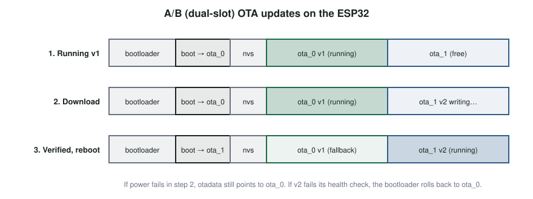

# Over-the-Air Updates and the Device Lifecycle {#sec-ch16}

::: {.callout-tip title="Learning objectives" appearance="simple"}
After this chapter you should be able to:

1. Describe the stages of an IoT device's lifecycle and the security work each requires.
2. Explain why devices must be updatable, and what a robust over-the-air (OTA) update system needs on both server and device.
3. Explain A/B partitions, image verification and rollback on the ESP32.
4. Describe secure boot and the chain of trust from ROM to application.
5. Explain flash encryption and the role of eFuses in protecting a deployed device.
6. Plan staged rollouts, monitoring and end-of-life for a fleet of devices.
:::

## Why it matters

Every non-trivial program has bugs, and some of them are security vulnerabilities. For a laptop or phone, the fix arrives as an update the next week. For an IoT device, someone has to build an update mechanism into the product before it ships, or the bug is permanent. Recalling devices or sending technicians to thousands of sites is rarely possible.

A broken update mechanism is worse than none. An update that fails halfway through, or that installs firmware that crashes, can turn every device in the field into a "brick". An update mechanism that accepts unsigned firmware hands attackers a way to install their own code on the whole fleet. Getting updates right, and securing the boot process that runs them, is one of the most important engineering tasks in IoT.

## Concepts

### The device lifecycle

An IoT device passes through several stages, and security must be considered in each:

| Stage | Activities | Security concerns |
|---|---|---|
| **Design** | Architecture, component choice, threat modeling | Choosing hardware with a root of trust; planning for updates |
| **Manufacture** | Building and testing; flashing firmware | Protecting signing keys; injecting unique identities (@sec-ch15) |
| **Provisioning and onboarding** | Registering the device and connecting it to an owner | Proving genuineness; claiming ownership securely |
| **Operation** | Normal use, monitoring, remote configuration | Detecting faults and attacks; protecting data |
| **Update** | Fixing bugs and vulnerabilities, adding features | Authentic, reliable updates; recovering from failures |
| **Transfer** | Resale or change of owner | Removing the previous owner's access and data |
| **Decommissioning** | Retirement and disposal | Wiping data and credentials; revoking identities |

: The IoT device lifecycle. {#tbl-lifecycle}

Embedded programmers must assume a deployed device is physically unreachable (@sec-ch04). The update mechanism is therefore the only way to change a device's behavior for the rest of its life.

### Over-the-air updates

An **over-the-air** (OTA) update delivers new software to a device through its network connection: directly over Wi-Fi or cellular, or through a gateway that relays it over a local link such as Bluetooth. OTA updates are routine in phones and cars, where they update everything from infotainment screens to engine and brake control software.

To reduce download time and cost, updates are often sent as a **delta**: only the differences between the old and new image, which the device applies to its current firmware. The delta, together with metadata and security credentials (the signature, version numbers, target hardware), forms an **update package**.

A complete OTA system has two halves:

| Server side | Device side |
|---|---|
| Management of users, devices and groups | Agnostic to the network used to deliver the image |
| Scalable, highly available distribution (often a CDN) | Small enough to fit in flash alongside the application |
| Authentication and authorization for publishing updates | Verifies authenticity and integrity before installing |
| An API for devices to check for and fetch updates | Survives power loss at any moment during the update |
| Delta generation and compression | Supports rollback and recovery from bad images |
| Staged rollout, monitoring and analytics | Integrates with secure boot and the device's identity |

: Requirements of an OTA update system. {#tbl-ota-reqs}

### A/B partitions on the ESP32

The ESP32 stores its firmware in external flash, divided into **partitions** described by a partition table. An OTA-capable layout includes:

- **`otadata`**: a small partition recording which application slot to boot;
- **`ota_0`** and **`ota_1`**: two application slots;
- optionally a **`factory`** slot with a known-good image;
- **`nvs`** for settings and other data partitions.

The device always runs from one slot and downloads updates into the other (@fig-ota-ab). Only when the new image has been completely written and verified does it update `otadata` to point at the new slot and reboot. If power fails during the download, the old image is untouched and still marked as the one to boot. This **A/B** (dual-bank) scheme is the core of reliable updates.

{#fig-ota-ab width="90%"}

#### Rollback

A new image can be complete and correctly signed, yet still fail: it crashes on start-up, cannot connect to the network, or cannot reach the update server, which would make it impossible to fix with another update. With **rollback** enabled, the bootloader marks a newly installed image as *pending verification*. The new firmware must run its self-tests and then confirm that it is healthy; if it reboots before confirming, the bootloader returns to the previous image.

```cpp
#include <esp_ota_ops.h>

void confirmFirmwareIfHealthy() {
  const esp_partition_t* running = esp_ota_get_running_partition();
  esp_ota_img_states_t state;
  if (esp_ota_get_state_partition(running, &state) == ESP_OK &&
      state == ESP_OTA_IMG_PENDING_VERIFY) {
    bool ok = connectWiFi() && reachUpdateServer() && sensorsRespond();  // your checks
    if (ok) esp_ota_mark_app_valid_cancel_rollback();
    else    esp_ota_mark_app_invalid_rollback_and_reboot();
  }
}
```

(Rollback must be enabled when the bootloader is built, which the default Arduino-ESP32 configuration does not do; it is available with ESP-IDF, or with PlatformIO using the ESP-IDF framework or custom configuration.)

### Fetching updates

The Arduino-ESP32 core offers two update paths:

- **ArduinoOTA** lets a developer push new firmware from PlatformIO over the local network instead of over USB. It is convenient during development but does not scale to a fleet.
- **HTTP(S) update** lets a device pull an image from a server:

```cpp
#include <WiFiClientSecure.h>
#include <HTTPUpdate.h>

void checkForUpdate() {
  WiFiClientSecure tls;
  tls.setCACert(ROOT_CA_PEM);                     // authenticate the update server
  httpUpdate.rebootOnUpdate(true);
  t_httpUpdate_return r = httpUpdate.update(
      tls, "https://updates.example.org/kit/firmware.bin", FIRMWARE_VERSION);
  switch (r) {
    case HTTP_UPDATE_NO_UPDATES: Serial.println("Up to date"); break;
    case HTTP_UPDATE_FAILED:
      Serial.printf("Update failed: %s\n", httpUpdate.getLastErrorString().c_str());
      break;
    case HTTP_UPDATE_OK: break;                   // not reached: the device reboots
  }
}
```

TLS authenticates the *server* and protects the image in transit. That is necessary but not sufficient: if the update server itself is compromised, it can serve malicious firmware over a perfectly valid TLS connection. The image itself must be **signed** by the developer, and the device must verify the signature before installing or booting it. That is the job of secure boot.

### Secure boot and the chain of trust

**Secure boot** ensures that a device runs only software signed by its legitimate developer. It builds a **chain of trust** in which each stage verifies the next before handing over control:

1. **Key generation.** The developer creates a signing key pair and keeps the private key in a secure location, ideally a hardware security module.
2. **Signing.** Each firmware image is hashed, and the digest is signed with the private key. The signature is attached to the image.
3. **Verification at boot.**
   - The **ROM bootloader** runs first. It is in mask ROM inside the chip, so it cannot be modified and is trusted by definition.
   - The ROM reads the public key attached to the second-stage bootloader, hashes it, and compares the hash with a **digest stored in eFuses** (below). If they match, it verifies the bootloader's signature with that key.
   - The verified **bootloader** repeats the process for the application image, before running it and before accepting an OTA image.

Why store only a **hash** of the public key in the eFuses rather than the key itself? eFuse space is scarce (a 3 072-bit RSA key would not fit in a 256-bit block), and a hash is enough to confirm that the key presented with the image is the right one.

On the ESP32, **Secure Boot V2** (available on chip revision 3 and later) uses RSA-3072 signatures with the scheme above; newer Espressif chips also support ECDSA. The original Secure Boot V1 used a symmetric scheme and is now deprecated.

### eFuses

The ESP32 contains 1 024 bits of **eFuse** memory: one-time-programmable bits, organized in four 256-bit blocks, that are burned by a high current and can never be reset. They hold:

- the **flash-encryption key** and the **secure-boot key digest**, in blocks that can be made **read-protected**, so that only the hardware can use them and no software (including the device's own firmware) can read them;
- **configuration bits** that permanently enable secure boot and flash encryption, and permanently **disable** features an attacker could abuse, such as JTAG debugging and the UART download mode used to flash new firmware over USB.

Because eFuses are permanent, enabling secure boot or flash encryption on a production device is a one-way decision. Mistakes can brick the chip, so these features are practiced on spare boards, never on a kit you need.

### Flash encryption

Secure boot stops a device from running unauthorized code, but it does not stop someone from reading the flash chip to extract firmware, Wi-Fi passwords or keys stored in software. **Flash encryption** protects the contents of the external flash with AES:

- Firmware is flashed as plain text, and encrypted in place on the first boot.
- From then on, all memory-mapped reads from flash are decrypted transparently by hardware as code runs, and writes are encrypted, using the key in the eFuses.
- Someone who removes and reads the flash chip sees only ciphertext.

Secure boot and flash encryption are designed to be used together, with JTAG and UART download disabled, for production devices.

### Operating a fleet

Shipping an update mechanism is only the start. Running it safely across thousands of devices requires:

- **Version management**: every device reports its firmware version, and the server knows which versions exist where.
- **Staged rollouts**: release to a small percentage of devices first, watch crash rates and health metrics, then expand. Halt automatically if failures rise.
- **Anti-rollback**: prevent attackers from installing an *older*, validly signed but vulnerable version, using a security version number checked against an eFuse or secure-element counter.
- **Monitoring and logging**: health reports, crash dumps and connectivity statistics, so problems are visible before customers report them.
- **Remote configuration**: changing parameters without a full firmware update.
- **A software bill of materials** (SBOM): a list of all software components and versions in each image, so that when a vulnerability is announced in a library, you know which devices are affected.
- **A support period**: a published commitment to how long security updates will be provided, increasingly a legal requirement (@sec-ch17).
- **End of life**: when support ends, devices should fail safe, and owners should be able to wipe them.

::: {.callout-tip title="Try it on your kit: a safe update"}
Use a spare board or the Wokwi simulator for steps that change eFuses; never burn eFuses on a kit you need.

1. Print the running partition's label and the firmware version at boot. Use PlatformIO's partition table option to select a layout with two OTA slots.
2. Host two firmware versions on a laptop web server and update the kit over HTTP, then HTTPS. Confirm that the running slot changes.
3. Pull the USB cable in the middle of an update. What does the kit run when power returns, and why?
4. Write the health checks your project firmware should run before confirming a new image.
5. Write a short plan (one page) for updating 500 deployed kits: rollout stages, metrics, halt criteria and rollback.
:::

## Design trade-offs

| Decision | Considerations |
|---|---|
| Full images vs. deltas | Deltas save bandwidth but need the exact old image and more complex tooling |
| Push vs. pull | Pull (device checks periodically) works through NAT; push (server notifies) gives faster response |
| Automatic vs. user-approved updates | Automatic updates patch faster; user approval respects control but leaves devices unpatched |
| Secure boot and flash encryption | Strong protection, at the cost of irreversible configuration and harder debugging |
| Factory image | A known-good fallback costs flash space |

## Common pitfalls

- **One firmware slot.** A failed update bricks the device.
- **TLS without image signing.** A compromised server can push malicious firmware.
- **No health check before confirming.** A new image that cannot reach the update server can never be fixed.
- **Signing keys on a developer laptop** or in a CI system without protection.
- **Updating the whole fleet at once.**
- **No anti-rollback**, allowing downgrade attacks.
- **Burning eFuses on development boards** by accident.
- **Forgetting the end of life.** Unsupported devices stay on networks for years.

::: {.callout-note title="Advanced track" collapse="true"}
**Update frameworks.** Compare the ESP-IDF OTA APIs with general-purpose update frameworks such as Mender, SWUpdate, RAUC, and MCUboot (used with Zephyr). The IETF SUIT working group defines a standard manifest format for IoT firmware updates; read its architecture document (RFC 9019) and map its concepts onto the ESP32.

**The Uptane framework.** Vehicle updates use Uptane, which separates the roles of image repository and director, and uses multiple keys with different privileges, so that compromising one server is not enough to install malicious firmware. Explain how this design defends against a compromised update server.
:::

## Check your understanding

1. List the stages of an IoT device's lifecycle, with one security task for each.
2. Why is an A/B partition scheme safer than overwriting the running firmware?
3. What is rollback, and what must the new firmware do to prevent it?
4. Why is TLS on the update download not enough to guarantee authentic firmware?
5. Describe the chain of trust in secure boot. Why is the ROM bootloader trusted?
6. Why store a hash of the public key in eFuses rather than the key itself?
7. What does flash encryption protect against that secure boot does not?
8. What is a downgrade attack, and how is it prevented?

## Further reading

- Espressif, *ESP-IDF Security Guides: Secure Boot V2 and Flash Encryption* [@espressif_idf_security].
- Espressif, *ESP-IDF Over The Air Updates (OTA)* [@espressif_idf_ota].
- RFC 9019, *A Firmware Update Architecture for Internet of Things* [@rfc9019].
