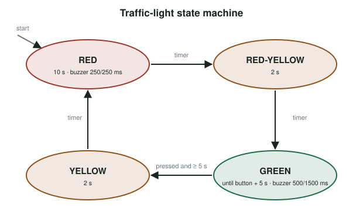

# Lab 2: Traffic Controller {#sec-lab-l2 .unnumbered}

::: {.callout-note title="Lab Companion" appearance="simple"}
Pin numbers reflect the current kit. If your term's handout differs, **it wins**.
:::

## Goals

- Design and implement a **finite-state machine** on a microcontroller.
- Use non-blocking timing with `millis()` so several behaviors run at once (@sec-ch03).
- Think about safe default states and accessibility (@sec-ch07).

Uses: Stage 1 of the kit ([Lab 1](/part7-lab-companion/L1-build-the-kit.qmd)): LED 1 red (GPIO 2), LED 2 yellow (GPIO 4), LED 3 green (GPIO 15), button 1 (GPIO 32), buzzer (GPIO 27).

## The problem

Build a simplified pedestrian traffic light for a road crossing:

1. The light cycles **green → yellow → red → red-yellow → green**.
2. **Red** lasts **10 seconds**. **Yellow** and **red-yellow** each last **2 seconds**.
3. The light **stays green** until a pedestrian presses the button. After the button is pressed, it stays green for **at least 5 more seconds** before changing to yellow.
4. A **buzzer** helps people with visual impairments: while green, it sounds **500 ms on, 1 500 ms off**; while red, it sounds **250 ms on, 250 ms off**. It is silent in the other states.

(A fingertip on top of the buzzer lowers the volume, which your lab neighbors will appreciate.)

## Design

Model the light as a **state machine** with four states: `RED`, `RED_YELLOW`, `GREEN` and `YELLOW`, as shown below.

{width="80%" fig-alt="Traffic-light state machine with four states: red, red-yellow, green and yellow"}

Each state has:

- **outputs**: which LEDs are on, and the buzzer pattern;
- **transitions**: the conditions (timer expired, button pressed) that move to the next state.

Keep the **buzzer** as a second, independent state machine (on/off, with its own timer) that reads the current traffic-light state to choose its pattern. Neither machine may use `delay()`: the button must be noticed immediately, whatever the buzzer is doing.

## A starting structure

```cpp
#include <Arduino.h>
#include "iot_pins.h"

enum class Light { RED, RED_YELLOW, GREEN, YELLOW };

constexpr uint32_t RED_MS = 10000, AMBER_MS = 2000, MIN_GREEN_AFTER_PRESS_MS = 5000;

Light state = Light::RED;            // what is the safest initial state?
uint32_t stateStart = 0;
bool requested = false;              // pedestrian pressed the button
uint32_t requestTime = 0;

void setLights(bool r, bool y, bool g) {
  digitalWrite(IoTPins::LED_1, r);
  digitalWrite(IoTPins::LED_2, y);
  digitalWrite(IoTPins::LED_3, g);
}

void enter(Light s) { state = s; stateStart = millis(); }

void setup() {
  pinMode(IoTPins::LED_1, OUTPUT);
  pinMode(IoTPins::LED_2, OUTPUT);
  pinMode(IoTPins::LED_3, OUTPUT);
  pinMode(IoTPins::BUTTON_1, INPUT_PULLUP);
  enter(Light::RED);
}

void updateLight() {
  uint32_t inState = millis() - stateStart;
  switch (state) {
    case Light::RED:
      setLights(1, 0, 0);
      if (inState >= RED_MS) enter(Light::RED_YELLOW);
      break;
    case Light::RED_YELLOW:
      // TODO: outputs and transition to GREEN
      break;
    case Light::GREEN:
      // TODO: stay green until requested, then at least 5 s after the request
      break;
    case Light::YELLOW:
      // TODO: outputs and transition to RED; clear the request
      break;
  }
}

void updateButton() {
  // TODO: detect a debounced press; set requested and requestTime
}

void updateBuzzer() {
  // TODO: second state machine; pattern depends on `state`
}

void loop() {
  updateButton();
  updateLight();
  updateBuzzer();
}
```

Use `tone(IoTPins::BUZZER, frequency)` and `noTone(IoTPins::BUZZER)` to switch the buzzer on and off.

## Testing

Write a short test plan before demonstrating:

| Test | Expected result |
|---|---|
| Power on | The light starts in the state you chose as safest |
| No button press | Light cycles to green and stays green indefinitely |
| Press during green, more than 5 s after entering green | Green lasts 5 more seconds, then yellow (2 s), red (10 s), red-yellow (2 s), green |
| Press during red | Does the press carry over? Decide, document and justify |
| Hold the button down | No repeated or stuck requests |
| Buzzer | 500/1500 ms pattern in green, 250/250 ms in red, silent otherwise, never blocking the button |

Time each state with a stopwatch or by printing timestamps over the serial port.

## What to show and submit

- A live demonstration of every requirement to a TA.
- Your code, with the state machine clearly structured.
- A text file answering the analysis questions.

## Analysis questions

1. Why does the light stay green if the button is never pressed? Is that a sensible design for a road crossing?
2. What is the safest initial state when the controller powers up or resets? Why?
3. What would you add to make the crossing safer for people with auditory or visual impairments?
4. What should the controller do if it detects that a lamp has failed?
